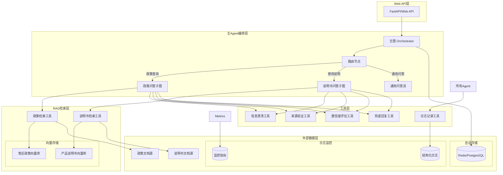

我将基于您的需求和项目结构，设计一个售后客服AI Agent的技术方案。

## 1. 整体架构图 (Mermaid)



## 2. 各 Agent / SubGraph 的职责

### 主图 (Orchestrator)
- **职责**: 用户请求入口，路由分发，会话管理，结果聚合
- **节点**: 路由判断、流程编排、结果格式化

### 政策问答子图 (PolicyAgent)
- **职责**: 处理售后政策相关查询
- **节点**: 政策查询预处理、RAG检索、政策解读、结果生成

### 说明书问答子图 (ManualAgent)
- **职责**: 处理产品使用、操作、保养、故障排查等说明书类查询
- **节点**: 说明书查询预处理、RAG检索、技术解读、结果生成

### 通用问答流 (NormalAgent)
- **职责**: 处理通用客服问答，不涉及RAG检索的场景
- **节点**: 意图识别、通用回复、转人工判断

## 3. 每个节点的输入、处理逻辑和输出

### 主图节点:

#### 1. 路由节点 (Router)
- **输入**: 用户query、会话历史
- **处理逻辑**:
  - 使用分类模型判断query类型（政策/说明书/通用）
  - 基于关键词+语义双重判断
  - 检查是否缺少关键信息（产品型号、故障现象等）
- **输出**: 路由决策 + 缺失信息标识

#### 2. 会话管理器 (SessionManager)
- **输入**: 用户ID、会话状态、query
- **处理逻辑**:
  - 加载/创建会话
  - 维护多轮对话上下文
  - 存储澄清信息和用户补充
- **输出**: 增强的query上下文、会话ID

### 政策问答子图节点:

#### 1. 政策检索器 (PolicyRetriever)
- **输入**: 增强的query、过滤器（产品线、地区等）
- **处理逻辑**:
  - 查询向量数据库获取top-k相关政策片段
  - 应用相关性过滤
  - 按条款章节排序
- **输出**: 相关政策片段列表，带来源信息

#### 2. 政策解析器 (PolicyAnalyzer)
- **输入**: 检索结果、用户query
- **处理逻辑**:
  - 合并相关条款
  - 解析政策条款条件（时间、产品、地区限制）
  - 生成结构化政策解读
- **输出**: 结构化政策信息、适用性评估

### 说明书问答子图节点:

#### 1. 说明书检索器 (ManualRetriever)
- **输入**: 增强的query、产品型号、故障现象
- **处理逻辑**:
  - 按产品型号过滤检索
  - 多阶段检索（故障描述→操作步骤→保养说明）
  - 相关性评分和排序
- **输出**: 相关说明书片段列表，带页码/章节信息

## 4. 父图与子图的 State 数据契约

State 设计已改为“薄父图 + 独立子图”，以 `docs/design/agent_state_design.md` 为准。

- 父图：`OrchestratorState`，只保存跨轮/对外/决策字段；
- 政策子图：`PolicyAgentState`，输入 `{user_query, context_query}`；
- 说明书子图：`ManualAgentState`，输入 `{user_query, context_query}`；
- 子图统一输出 `{final_answer, source_citations, should_escalate, needs_clarification, clarification_question}`；
- 父图通过 `policy_wrapper_node` / `manual_wrapper_node` 完成契约翻译；
- `documents` 是真实 `List[Document]`，不是 embedding 向量；
- 父图与子图不再继承 `SharedState`。

## 5. Tool 的定义和参数 Schema

### 工具1: `retrieve_policy_documents`
```python
class PolicyRetrieverToolSchema(BaseModel):
    query: str = Field(description="用户查询的政策问题")
    product_line: Optional[str] = Field(None, description="产品线过滤")
    region: Optional[str] = Field(None, description="地区过滤")
    date_range: Optional[Tuple[datetime, datetime]] = Field(None, description="时间范围")
    top_k: int = Field(5, description="返回文档数量")
    
class PolicyRetrieverTool(Tool):
    name = "retrieve_policy_documents"
    description = "从售后政策知识库中检索相关政策文档"
    args_schema = PolicyRetrieverToolSchema
    
    def _run(self, **kwargs) -> List[PolicyDocument]:
        # 实现逻辑
```

### 工具2: `retrieve_manual_documents`
```python
class ManualRetrieverToolSchema(BaseModel):
    query: str = Field(description="用户查询的产品使用问题")
    product_model: Optional[str] = Field(None, description="产品型号")
    issue_type: Optional[str] = Field(None, description="问题类型: operation/maintenance/troubleshooting")
    include_diagrams: bool = Field(True, description="是否包含图表")
    top_k: int = Field(5, description="返回文档数量")
```

### 工具3: `clarify_missing_info`
```python
class ClarificationToolSchema(BaseModel):
    missing_fields: List[str] = Field(description="缺失的信息字段列表")
    context: str = Field(description="当前对话上下文")
    clarification_strategy: str = Field("single", description="澄清策略: single/multiple/choice")
    
class ClarificationTool(Tool):
    name = "clarify_missing_info"
    description = "当查询缺少关键信息时，向用户提问澄清"
    args_schema = ClarificationToolSchema
```

### 工具4: `validate_sources`
```python
class SourceValidationToolSchema(BaseModel):
    documents: List[Document] = Field(description="待验证的文档列表")
    query: str = Field(description="原始查询")
    validation_threshold: float = Field(0.7, description="验证阈值")
    
class SourceValidationTool(Tool):
    name = "validate_sources"
    description = "验证检索到的文档是否确实相关且可信"
    args_schema = SourceValidationToolSchema
```

### 工具5: `assess_confidence`
```python
class ConfidenceAssessmentToolSchema(BaseModel):
    query: str = Field(description="用户查询")
    retrieved_docs: List[Document] = Field(description="检索到的文档")
    validation_scores: List[float] = Field(description="验证分数")
    model_confidence: float = Field(description="模型的原始置信度")
    
class ConfidenceAssessmentTool(Tool):
    name = "assess_confidence"
    description = "评估回答的总体置信度"
    args_schema = ConfidenceAssessmentToolSchema
```

### 工具6: `generate_fallback_response`
```python
class FallbackResponseToolSchema(BaseModel):
    query: str = Field(description="用户查询")
    failure_reason: str = Field(description="失败原因")
    available_information: Dict[str, Any] = Field(description="可用的信息")
    
class FallbackResponseTool(Tool):
    name = "generate_fallback_response"
    description = "当无法提供确切答案时生成兜底回复"
    args_schema = FallbackResponseToolSchema
```

## 6. 正常业务流程

### 流程A: 完整政策查询流程
1. **用户输入**: "我的XX产品买了3个月，屏幕坏了能保修吗？"
2. **路由判断**: 识别为政策查询，检查缺失信息（具体产品型号）
3. **信息澄清**: 如果缺少产品型号，提问澄清："请问您的具体产品型号是什么？"
4. **用户补充**: "型号是XX-2024"
5. **政策检索**: 检索相关保修政策
6. **政策解析**: 分析保修期限、屏幕损坏政策
7. **结果生成**: "根据保修政策，XX-2024产品屏幕损坏在一年保修期内可以免费维修，需要您提供购买凭证..."
8. **输出**: 回答+引用（条款3.2）+联系方式

### 流程B: 说明书查询完整流程
1. **用户输入**: "我的洗衣机不脱水了怎么办？"
2. **路由判断**: 识别为说明书查询（故障排查）
3. **信息澄清**: "请问您的洗衣机具体型号是？"
4. **用户补充**: "型号是WX-1000"
5. **说明书检索**: 检索WX-1000的故障排除章节
6. **步骤生成**: "请按以下步骤排查：1.检查排水管是否堵塞 2.检查盖板开关..."
7. **安全警告**: "操作前请确保断开电源"
8. **输出**: 分步骤指导+页码引用+安全提醒

### 流程C: 低置信度处理流程
1. **用户输入**: "我的量子洗衣机时间旅行功能坏了"
2. **路由+检索**: 检索结果为低相关性/空结果
3. **置信评估**: 置信度<0.3
4. **兜底回复**: "抱歉，我暂时无法找到关于量子洗衣机时间旅行功能的信息。建议您..."
5. **转人工建议**: "是否需要为您转接人工客服？"

## 7. 异常处理流程

### 异常类型和处理策略:

#### 1. 检索异常 (RetrievalError)
- **场景**: 向量数据库连接失败，检索超时
- **处理**:
  - 重试机制（最多3次）
  - 降级到关键词检索
  - 日志记录+告警
  - 返回通用回复模板

#### 2. LLM生成异常 (GenerationError)
- **场景**: LLM API失败，生成内容异常
- **处理**:
  - 切换备用LLM（如果配置）
  - 使用模板化回复
  - 记录错误上下文
  - 返回错误友好的兜底回复

#### 3. 数据验证异常 (ValidationError)
- **场景**: 检索结果与查询高度不相关
- **处理**:
  - 触发低置信流程
  - 追加澄清问题
  - 提示用户重新表述

#### 4. 超时异常 (TimeoutError)
- **场景**: 处理时间超过阈值
- **处理**:
  - 终止当前处理
  - 异步继续处理
  - 返回"处理中"状态
  - 提供查询ID供稍后检查

## 8. 日志和可观测性设计

### 日志层级:
```
1. DEBUG: 详细流程跟踪（节点进入/退出，中间结果）
2. INFO: 业务流程日志（查询类型，处理结果，耗时）
3. WARNING: 异常处理（降级，重试）
4. ERROR: 系统错误（API失败，数据库异常）
5. CRITICAL: 系统不可用
```

### 结构化日志字段:
```python
{
    "timestamp": "2024-01-01T12:00:00Z",
    "level": "INFO",
    "service": "customer-service-agent",
    "session_id": "sess123",
    "query_id": "q123",
    "query_type": "policy",
    "processing_time_ms": 1200,
    "retrieval_count": 5,
    "retrieval_confidence": 0.85,
    "final_confidence": 0.78,
    "clarification_rounds": 1,
    "user_id": "user456",
    "error_code": None,
    "metadata": {...}
}
```

### 监控指标:
```python
# Prometheus指标
QUERY_TOTAL = Counter('customer_service_queries_total', 'Total queries')
QUERY_DURATION = Histogram('customer_service_query_duration_seconds', 'Query processing time')
RETRIEVAL_SUCCESS_RATE = Gauge('customer_service_retrieval_success_rate', 'Retrieval success rate')
CONFIDENCE_DISTRIBUTION = Histogram('customer_service_confidence_distribution', 'Response confidence distribution')
CLARIFICATION_REQUESTS = Counter('customer_service_clarification_requests', 'Clarification requests')
FALLBACK_RESPONSES = Counter('customer_service_fallback_responses', 'Fallback responses')
```

### 跟踪设计:
- **Trace ID**: 贯穿整个请求链
- **Span**: 每个节点/工具执行都创建span
- **Attributes**: 记录关键参数和结果
- **Jaeger/OTLP**: 分布式跟踪

## 9. 单元测试和集成测试方案

### 单元测试:

#### 1. 工具测试
```python
def test_policy_retriever_tool():
    """测试政策检索工具"""
    tool = PolicyRetrieverTool()
    result = tool.run(query="保修政策", product_line="洗衣机")
    assert len(result) > 0
    assert all(hasattr(doc, 'source') for doc in result)

def test_clarification_tool():
    """测试澄清工具"""
    tool = ClarificationTool()
    result = tool.run(missing_fields=["product_model"], context="洗衣机不工作了")
    assert "产品型号" in result
    assert "请问" in result
```

#### 2. 节点测试
```python
def test_router_node():
    """测试路由节点"""
    node = RouterNode()
    state = SharedState(query="如何保修")
    new_state = node.run(state)
    assert new_state.query_type in ["policy", "manual", "general"]
    assert 0 <= new_state.confidence <= 1

def test_policy_analyzer_node():
    """测试政策解析节点"""
    node = PolicyAnalyzerNode()
    docs = [Document(content="保修期一年", metadata={"section": "3.1"})]
    state = PolicyAgentState(retrieved_docs=docs, query="保修多长时间")
    new_state = node.run(state)
    assert "一年" in new_state.response
    assert len(new_state.source_citations) > 0
```

#### 3. State模型测试
```python
def test_state_validation():
    """测试State模型验证"""
    # 正确的state应该通过验证
    state = SharedState(query="test", user_id="user123", session_id="sess123")
    assert state.is_valid()
    
    # 缺失必需字段应该失败
    with pytest.raises(ValidationError):
        state = SharedState(query="test")
```

### 集成测试:

#### 1. 端到端流程测试
```python
@pytest.mark.integration
def test_policy_query_end_to_end():
    """测试政策查询完整流程"""
    # 准备测试数据
    test_query = "洗衣机买了6个月漏水怎么办"
    
    # 执行完整流程
    result = orchestrator.process_query(test_query, user_id="test_user")
    
    # 验证结果
    assert result["success"] is True
    assert result["response"] != ""
    assert result["confidence"] >= 0.5
    assert "保修" in result["response"] or "维修" in result["response"]
    assert len(result["sources"]) > 0
```

#### 2. RAG检索集成测试
```python
@pytest.mark.integration
def test_rag_retrieval_accuracy():
    """测试RAG检索准确性"""
    # 准备测试查询和预期答案
    test_cases = [
        ("保修期多久", ["一年", "12个月"]),
        ("如何清洗滤网", ["取出", "清洗", "放回"]),
    ]
    
    for query, expected_keywords in test_cases:
        result = retriever.retrieve(query)
        combined_text = " ".join([doc.content for doc in result])
        assert any(keyword in combined_text for keyword in expected_keywords)
```

#### 3. 多轮对话测试
```python
@pytest.mark.integration
def test_multi_round_conversation():
    """测试多轮对话"""
    session_id = "test_session"
    
    # 第一轮：用户提出不完整问题
    result1 = orchestrator.process_query(
        "我的设备坏了怎么办", 
        user_id="test_user",
        session_id=session_id
    )
    assert result1["needs_clarification"] is True
    assert "什么设备" in result1["clarification_question"]
    
    # 第二轮：用户补充信息
    result2 = orchestrator.process_query(
        "电视机",
        user_id="test_user",
        session_id=session_id,
        is_clarification=True
    )
    assert result2["needs_clarification"] is False
    assert "电视机" in result2["response"]
```

### 模拟测试:

#### 1. LLM响应模拟
```python
@pytest.fixture
def mock_llm():
    """模拟LLM响应"""
    class MockLLM:
        def invoke(self, prompt):
            if "政策" in prompt:
                return "根据政策第3.2条，保修期为一年。"
            elif "步骤" in prompt:
                return "1. 断开电源 2. 检查连接"
            return "这是一个通用回答。"
    return MockLLM()
```

#### 2. 向量数据库模拟
```python
@pytest.fixture
def mock_vector_db():
    """模拟向量数据库"""
    class MockVectorDB:
        def similarity_search(self, query, k=5):
            return [
                Document(
                    content="产品保修期为12个月",
                    metadata={"source": "policy_v1.2", "section": "3.2"}
                ),
                Document(
                    content="非人为损坏免费维修",
                    metadata={"source": "policy_v1.2", "section": "3.3"}
                )
            ]
    return MockVectorDB()
```

### 性能测试:

#### 1. 压力测试
```python
@pytest.mark.performance
def test_concurrent_requests():
    """测试并发请求处理"""
    with concurrent.futures.ThreadPoolExecutor(max_workers=10) as executor:
        futures = [
            executor.submit(
                orchestrator.process_query,
                f"测试查询{i}",
                f"user{i}"
            )
            for i in range(100)
        ]
        
        results = [f.result() for f in concurrent.futures.as_completed(futures)]
        assert all(r["success"] for r in results)
        assert max(r["processing_time_ms"] for r in results) < 5000  # 5秒超时
```

#### 2. 内存使用测试
```python
@pytest.mark.performance
def test_memory_usage():
    """测试内存使用"""
    import psutil
    import os
    
    process = psutil.Process(os.getpid())
    initial_memory = process.memory_info().rss
    
    # 执行一系列查询
    for i in range(100):
        orchestrator.process_query(f"压力测试{i}", "test_user")
    
    final_memory = process.memory_info().rss
    memory_increase = final_memory - initial_memory
    
    # 内存增加不应超过100MB
    assert memory_increase < 100 * 1024 * 1024
```

### 测试覆盖率目标:
- **单元测试覆盖率**: >85%
- **集成测试覆盖率**: >70%
- **端到端测试覆盖率**: 所有关键用户旅程
- **性能测试**: 所有关键路径的性能基准

## 项目假设和待确认项

### 技术假设:
1. **假设1**: 现有项目已具备基本的LangGraph/LangChain集成
   - 待确认: 当前项目是否已有LangGraph的基础设施

2. **假设2**: 向量数据库已部署并有数据
   - 待确认: 政策文档和说明书是否已向量化并入库
   - 需要: 如未完成，需要设计文档预处理和向量化流水线

3. **假设3**: 有可用的LLM服务接入
   - 待确认: 当前使用的LLM提供商和模型版本
   - 需要: 可能需要的模型调优和提示工程

### 业务假设:
1. **假设4**: 政策文档格式相对统一
   - 风险: 如果文档格式不一致，可能需要额外的预处理

2. **假设5**: 产品型号有规范命名
   - 待确认: 产品型号的命名规则和变体处理
   - 需要: 可能的模糊匹配或标准化流程

3. **假设6**: 用户查询以中文为主
   - 影响: 模型选择和提示工程语言

### 扩展性考虑:
1. **未来扩展**: 如果需要支持多语言，需要设计语言检测和路由
2. **知识库更新**: 设计文档变更时的重新索引机制
3. **模型升级**: 设计AB测试框架支持模型升级验证
4. **新业务域**: 子图设计支持新增问题类型（如订单查询、服务预约等）

此方案基于现有项目结构设计，保留了扩展性但避免了过度抽象，聚焦于解决具体的售后客服需求。