#### 家用电冰箱 

产品名称： 冷藏箱、冷藏冷冻箱 

注意： 

###### 目录： 

接通电源前，请仔细阅读说明书，正确使用冰箱，并妥善保管。 冰箱外观、颜色或图案见实物。 由于产品的不断改进、您所购买的冰箱可能与说明书介绍不完全一样，谨以致歉。 生产日期及出厂编码见条形码。 

|结构示意图`……………………………………………………………………………………`|`1`|
|---|---|
|安全注意事项`…………………………………………………………………………………`|`6`|
|搬运及放置`……………………………………………………………………………………`|`14`|
|`LCD`触摸屏操作键功能说明`…………………………………………………………………`|`16`|
|温度调节`………………………………………………………………………………………`|`25`|
|间室使用说明`…………………………………………………………………………………`|`26`|
|除霜及灯更换`…………………………………………………………………………………`|`28`|
|零部件的使用`…………………………………………………………………………………`|`29`|
|清洁`……………………………………………………………………………………………`|`30`|
|冰箱停用`………………………………………………………………………………………`|`31`|
|故障判定`………………………………………………………………………………………`|`32`|
|非故障判断`……………………………………………………………………………………`|`33`|
|回收信息`………………………………………………………………………………………`|`34`|
|规格参数`………………………………………………………………………………………`|`35`|
|装箱清单`………………………………………………………………………………………`|`50`|
|维修说明`………………………………………………………………………………………`|`62`|
|本系列产品执行国家标准：||
|《 制冷器具 家用和类似用途 》 `GB/T8059`||
|《家用和类似用途电器的安全第一部分：通用要求》 `GB` `4706.1`||
|《家用和类似用途电器的安全 制冷器具、冰淇淋机和制冰机的特殊要求》 `GB` `4706.13`||
|《家用电器、电动工具和类似器具的电磁兼容要求 第一部分：发射》 `GB` `4343.1`||
|《电磁兼容 限值 谐波电流发射限值（设备每相输入电流≤`16A`）》 `GB` `17625.1`||
|《家用电冰箱耗电量限定值及能耗效率等级》 `GB` `12021.2`||
|《家用和类似用途电器噪声限值》 `GB` `19606`||

注1：本说明书为单/双门/多门冰箱通用说明书，某些特征及箱内配置可能与您的冰箱不完全相同，请以说明书的装箱清单为准！ 注2：冰箱外观、颜色和门图案见实物。 

###### <mark>结构示意图</mark> 

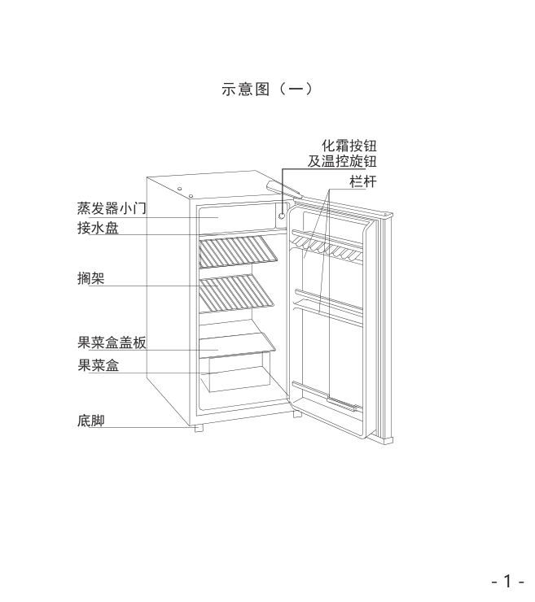

<!-- Start of picture text -->
示意图（一） 化霜按钮 及温控旋钮 栏杆 蒸发器小门 接水盘 搁架 果菜盒盖板 果菜盒 底脚 - 1 - <!-- End of picture text -->

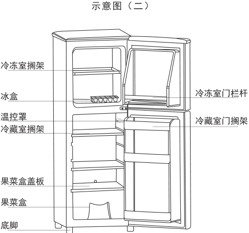

<!-- Start of picture text -->
示意图（二） 冷冻室搁架 冷冻室门栏杆 冰盒 温控罩 冷藏室门搁架 冷藏室搁架 果菜盒盖板 果菜盒 底脚 <!-- End of picture text -->

注1：本说明书为单/双门/多门冰箱通用说明书，某些特征及箱内配置可能与您的冰箱不完全相同，请以说明书的装箱清单为准！ 注2：冰箱外观、颜色和门图案见实物。 

###### <mark>结构示意图</mark> 

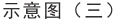

<!-- Start of picture text -->
示意图（三） <!-- End of picture text -->

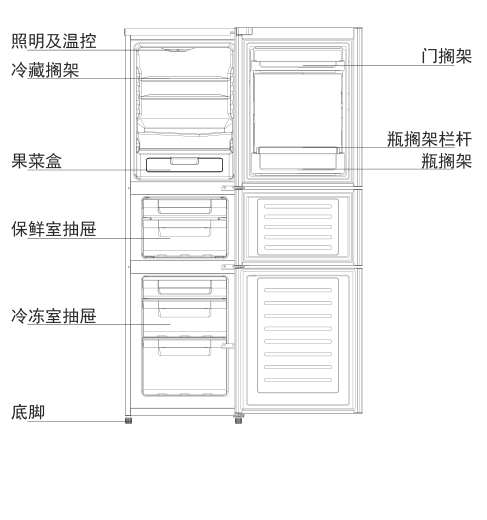

<!-- Start of picture text -->
照明及温控 门搁架 冷藏搁架 瓶搁架栏杆 果菜盒 瓶搁架 保鲜室抽屉 冷冻室抽屉 底脚 <!-- End of picture text -->

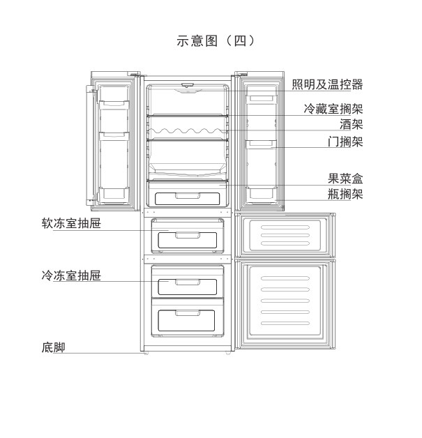

<!-- Start of picture text -->
示意图（四） 照明及温控器 冷藏室搁架 酒架 门搁架 果菜盒 瓶搁架 软冻室抽屉 冷冻室抽屉 底脚 <!-- End of picture text -->

- 2 - 

###### <mark>结构示意图</mark> 

注1：本说明书为单/双门/多门冰箱通用说明书，某些特征及箱内配置可能与您的冰箱不完全相同，请以说明书的装箱清单为准！ 注2：冰箱外观、颜色和门图案见实物。 

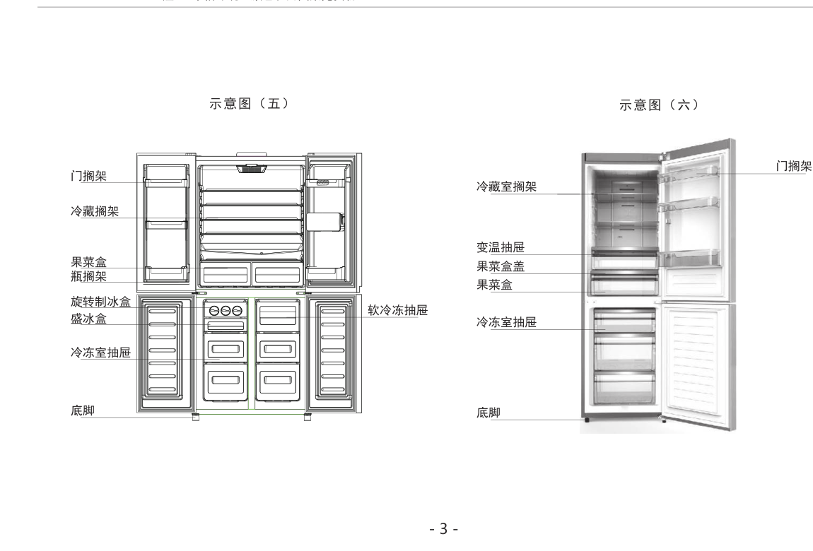

<!-- Start of picture text -->
示意图（五） 示意图（六） 门搁架 门搁架 冷 藏室搁架 冷藏搁架 变 温抽屉 果菜盒 果 菜盒盖 瓶搁架 果 菜盒 旋转制冰盒 软冷冻抽屉 盛冰盒 冷 冻室抽屉 冷冻室抽屉 底脚 底 脚 - 3 - <!-- End of picture text -->

注1：本说明书为单/双门/多门冰箱通用说明书，某些特征及箱内配置可能与您的冰箱不完全相同，请以说明书的装箱清单为准！ <mark>结构示意图</mark> 注2：冰箱外观、颜色和门图案见实物。 ~~mm~~ 

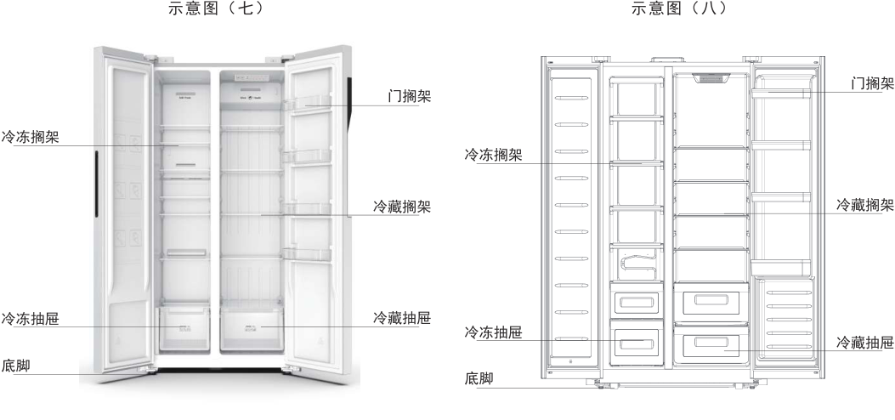

<!-- Start of picture text -->
示意图（七） 示意图（八） 门搁架 门搁架 冷冻搁架 冷冻搁架 冷藏搁架 冷藏搁架 冷冻抽屉 冷藏抽屉 冷冻抽屉 冷藏抽屉 底脚 a= 底脚 SSS <!-- End of picture text -->

- 4 - 

###### <mark>结构示意图</mark> 

注1：本说明书为单/双门/多门冰箱通用说明书，某些特征及箱内配置可能与您的冰箱不完全相同，请以说明书的装箱清单为准！ 注2：冰箱外观、颜色和门图案见实物。 

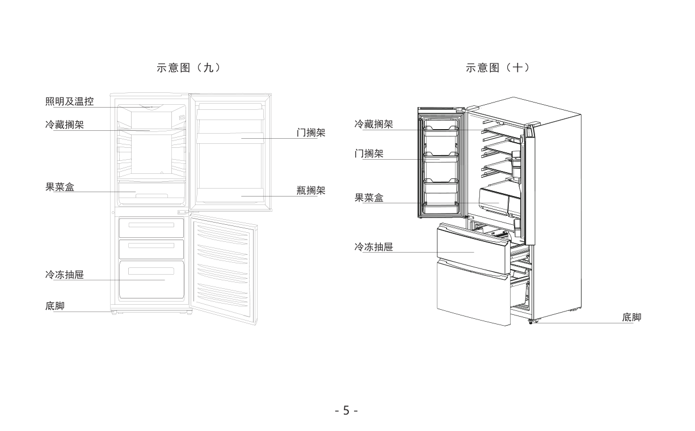

<!-- Start of picture text -->
示意图（九） 示意图（十） 照明及温控 冷藏搁架 冷藏搁架 门搁架 门搁架 果菜盒 瓶搁架 果菜盒 冷冻抽屉 冷冻抽屉 底脚 底脚 - 5 - <!-- End of picture text -->

###### <mark>安全注意事项</mark> 

- 6 - 

###### <mark>安全注意事项</mark> 

- 7 - 

###### <mark>安全注意事项</mark> 

- 8 - 

###### <mark>安全注意事项</mark> 

- 9 - 

###### <mark>安全注意事项</mark> 

- 10 - 

###### <mark>安全注意事项</mark> 

- 11 - 

- 12 

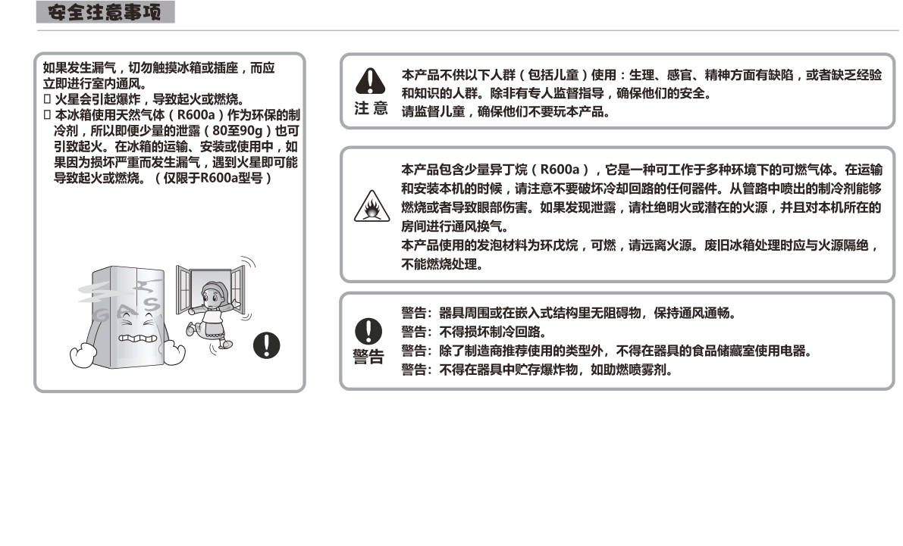

<!-- Start of picture text -->
Sitesi SNEOES SIRIIEpy , SRRIDICURNEIA.ERE | mo Q) D AAIRWAR.PHS  RITSAMEHEAR (HIE)GA:, mIRMIORam. BE, S .MienMEINS  eneE 0 SyKERR RPA ( R600a ) (ERR E R MeL MEIER. 2H), PRLLRDGEDRBANIIHRE ( 80390g ) tT SEREASUREIR.ceehs taetes.(RIRFREODARISee htamee)Seti SPRISPBSTS (R6O0a) , GSMAFSATNS. TiN ) ARAAMNHNE , HERTS, MEISNER A USSR, MURALI , TLIO SUAAEROI , FERRI AALA R IREESCERY Fe TRUBS. SPRERMDTATR , AM, TRIE, IBAEANBISYS aI , — ~\ FONE. a Teal it! | LLY I & =| Sr, Bs: RMSE ATORRIIM, (SRE. aco), 8 @ se: neanewens. — ( o > @ ee ES STMT, KETRRNRAMREESR, SF ges: RGEC TIREM, MOBNIMIRSER, <!-- End of picture text -->

- 13 

- 14 

- 15 

###### <mark>LED触摸屏操作键功能说明</mark> 

###### （速冷）速冷模式： 

冷藏室设定温度默认为2℃，速冷模式工作时间为3小时，冷冻室仍按照原设定温度运行，3小时退出速冷模式 后，自动恢复到之前的模式或设置。 （速冻）速冻模式： 温区选择键 速冻模式下，冷冻室设定温度默认为-25℃，速冻模式工作时间为26小时，冷藏室仍按照原设定温度运行，26 小时退出速冻后，自动恢复到之前的模式或设置。 温度显示区 （智能）智能模式： 智能模式下，冷藏室、冷冻室的设定温度分别默认为5℃、-18℃。 温度调节键 （假日）假日模式： 

（智能）智能模式： 智能模式下，冷藏室、冷冻室的设定温度分别默认为5℃、-18℃。 （假日）假日模式： 假日模式下，冷藏室设定温度默认为15℃，冷冻室仍按照原设定温度运行。 模式 按键解锁 持续按住     3秒以上，锁定解除，此时按键操作有效。 

冰箱模式图案 

模式/解锁键 

注意: 20秒不进行按键操作，自动锁定按键 60秒不进行按键操作，显示熄灭。此时轻按任何按键，显示恢复。 

###### ◆锁定与解锁 

按键锁定时，每次按键时，蜂鸣器响一声，锁图标闪烁一次。按住模式键（解锁键）约3秒以上，蜂鸣器响一声，锁图标熄灭，按键解锁。解锁后，无任何按 键操作约20秒后自动上锁，锁定图标点亮，冷藏与冷冻设定温度按3秒间隔循环显示， 约1分钟后LED屏熄灭。 

###### 温度设定步骤 

###### 1.冷藏室温度的设定 

解锁状态下，按温区选择键，上面两排指示灯亮表示进入冷藏温度调节状态，按温度调节键，冷藏温度可在8℃~2℃间连续循环调节，每次按键从当前设定 值起，按“5→4→3→2→8→7→6”在温度显示区显示冷藏温度设定值并闪烁，停止闪烁后设定生效。 2.冷冻室温度的设定 

解锁状态下，按温区选择键，下面两排指示灯亮表示进入冷冻温度调节状态，按温度调节键，冷冻温度可在-15℃~-25℃间循环调节，每次按键从当前设定 值起，按“-18→-19→… -24→-25→-15→-16→-17”在温度显示区显示冷冻温度设定值并闪烁，停止闪烁后设定生效。 

- 16 - 

###### <mark>LED触摸屏操作键功能说明</mark> 

按键锁定时，每次按键时，蜂鸣器响一声，锁图标闪烁一次。按住模式键（解锁键）约3秒以上，蜂鸣器响一声，锁图标熄灭，按键 解锁。解锁后，无任何按键操作约15秒后自动上锁， 约60秒后LED屏熄灭。 

###### 温度设定步骤 

###### 1.冷藏室温度设置 

解锁状态下，按温区选择键，上面指示灯亮后在温度显示区显示当前冷藏设定温度，按温度调节键，冷藏指示灯和显示温度均开始闪 烁，表示进入温度调节状态，冷藏温度可在8℃~2℃之间连续循环调节，每次按键从当前设定值起，按“5→4→3→2→8→7→6”显 示冷藏温度设定值并闪烁，停止闪烁后设定生效。 

###### 2.变温室温度设置 

解锁状态下，按温区选择键，中间指示灯亮后在温度显示区显示当前变温设定温度，按温度调节键，变温指示灯和显示温度均开始闪 烁，表示进入温度调节状态，变温温度可在-20℃~8℃之间连续循环调节，每次按键从当前设定值起，按“5→4→… -19→-20→8→ 7→6”在温度显示区显示变温温度设定值并闪烁，停止闪烁后设定生效。 

- 3.冷冻室温度设置 

解锁状态下，按温区选择键，下面指示灯亮后在温度显示区显示当前冷冻设定温度，按温度调节键，冷冻指示灯和显示温度均开始闪 烁，表示进入温度调节状态，冷冻温度可在-15℃~-25℃之间连续循环调节，每次按键从当前设定值起，按“-18→-19→… -24→ -25→-15→-16”在温度显示区显示冷冻温度设定值并闪烁，停止闪烁后设定生效。 

- 17 - 

<mark>LED触摸屏操作键功能说明</mark> ◆锁定与解锁 按键锁定时，每次按键时，蜂鸣器响一声，锁图标闪烁一次。按住模式键（解锁键）约3秒以上，蜂鸣器响一声，锁图标熄灭，按 键解锁。解锁后，无任何按键操作约20秒后自动上锁，锁定图标点亮，冷藏与冷冻设定温度按3秒间隔循环显示， 约1分钟后LED 屏熄灭。 温度设定步骤 1.冷藏室温度的设定 解锁状态下，按温区选择键，上面两排指示灯亮表示进入冷藏温度调节状态，按温度调节键，冷藏温度可在8℃~2℃间连续循环调节， 每次按键从当前设定值起，按“5→4→3→2→8→7→6”在温度显示区显示冷藏温度设定值并闪烁，停止闪烁后设定生效。 2.冷冻室温度的设定 解锁状态下，按温区选择键，下面两排指示灯亮表示进入冷冻温度调节状态，按温度调节键，冷冻温度可在-15℃~-25℃间循环调节， 每次按键从当前设定值起，按“-18→-19→… -24→-25→-15→-16→-17”在温度显示区显示冷冻温度设定值并闪烁，停止闪烁后设定 生效。 模式转换 ◆在解锁状态下，每按一次     按键，冰箱模式从当前模式（如无，则从智能模式开始）起，在“速冷”-“速冻”-“智能”-“假日”四种 模式中循环转换，相应模式图标和温度值闪烁，无按键10秒后停止闪烁，设定生效，当前模式指示图标亮。 ◆进行冷藏、冷冻温度设定时退出相关的模式，模式指示图标熄灭。 温度设定步骤 1.冷藏室温度的调节 解锁状态下，每按一次“冷藏室”按键，从当前设定值起，设置按“5→4→3…2→8→7”变化，设定温度值闪烁，10秒内无按键或按其他 间室选择键进入其他室设置，停止闪烁，设置生效。 2.冷冻室温度的调节 解锁状态下，每按一次“冷冻室”按键，从当前设定值起，设置按“-18→-19→-20…-25→-15→-16变化，设定温度值闪烁，10秒内无 按键或按其他间室选择键进入其他室设置，停止闪烁，设置生效。 ~~<mark>i</mark>~~ - 18 - 

###### <mark>LED触摸屏操作键功能说明</mark> 

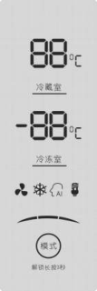

<!-- Start of picture text -->
88| aan oc -88 aa 2EOS —_—~ <!-- End of picture text -->

###### ◆锁定与解锁 

解锁后，无任何按键操作约20s后自动上锁， 约60s后LED屏熄灭。按键锁定时，每点动按键时，蜂鸣器响一声，锁图标（圆弧灯） - - 闪烁一次。按住解锁键约3s以上，蜂鸣器响一声，锁图标（圆弧灯）熄灭，按键解锁。解锁状态下，按动模式键，“速冷速冻智 - - 能节能速冷”图标会循环闪烁显示，同时冷冻室和冷冻室显示区会显示相应的设定温度。停止按键约10s停止闪烁，蜂鸣器响两 声，设定生效。 

- 温度设定步骤 

1.冷藏温度设置:按冷藏室调温键，冷藏温度可在8℃~2℃间连续循环调节，每次按键从当前设定值起，按“5→4→3→2→8→7→6” 在冷藏温度显示区显示冷藏设定温度值。 

- 2.冷冻温度设置：按冷冻室调温键，冷冻温度可在-15℃~-25℃间循环调节，每次按键从当前设定值起，按“-18→-19→…-24→ -25→-15→-16”在冷冻温度显示区显示冷冻设定温度值。如无特别说明，任何时候的任何按键操作，蜂鸣器短鸣一次及LED屏显 亮。 

- 3.“速冷”：冷冻室温度设定维持固定设定温度, 冷藏室的温度设定为2℃。进入“速冷”状态后超过约6h退出“速冷”状态，如是 从智能有效状态进入速冷，退出后仍恢复智能状态，否则，进入固定设定工作状态。 

- 4.“速冻”：冷冻室温度显示设定为-25℃, 冷藏室的温度设定维持固定设定温度。进入“速冻”状态后超过约26h退出“速冻”状 态，如是从智能有效状态进入速冻，退出后仍恢复智能状态，否则，进入固定设定工作状态。 

- 5.“智能”：表示冷藏温度显示设定为5℃，冷冻温度显示设定为-18℃。 

- 6.“节能”：表示冷藏温度显示设定为8℃，冷冻温度显示设定为-15℃。 

注意：任何门打开，LED屏点亮。所有门关闭后，60s后屏熄灭。 冰箱正常运行时，冷藏室、冷冻室温度显示为设定温度。 

- 19 - 

###### <mark>LED触摸屏操作键功能说明</mark> 

###### 冰箱默认冷藏温度设定为5℃ `，` 变温温度设定为-6℃ `，` 冷冻温度设定为-18℃ 

###### 温度设置 

- 1.冷藏温度设置：在解锁状态下，轻触冷藏调温键，冷藏温度可在8℃~2℃间连续循环调节 `，` 每次 按键从当前设定值起，按“5→4→3→2→8→7→6”在温度显示区显示冷藏温度设定值。 

###### 模式功能（所有模式均要在在解锁状态下） 

- 1.假日运行模式 `：` 

- 2.冷冻温度设置：在解锁状态下，轻触冷冻调温键，冷冻温度可在-15℃ `～` -25℃间循环调节 `，` 每次 按键从当前设定值起，按“-18→-19→… -24→-25→-15→-16”在温度显示区显示冷冻温度设定值。 3.变温温度设置：在解锁状态下，轻触变温调温键，变温温度可在8℃~-20℃间连续循环调节 `，` 每 次按键从当前设定值起，按“-6→-7→-8→…→-20→8→7”在温度显示区显示冷藏温度设定值。 

轻触假日模式键可进入或退出假日模式。当进入假日模式时，显示假日图标“   ”点亮。此模式下冷冻室温度按原设定温度运行，冷藏室温度设定15℃。 注：假日模式下不能进行冷藏调温，假日模式下按冷藏调温键时，假日图标闪烁提示不能进行此操作。 

- 2.节能运行模式： 

轻触节能模式键可进入或退出节能模式。当进入节能模式时，显示节能图标“   ”点亮。此模式下冷藏室温度设定为8℃ `，` 冷冻室温度设定为-15℃。 注：节能运行模式下不能进行冷藏和冷冻调温，节能模式下按冷藏调温键或冷冻调温键，节能图标闪烁提示不能进行此操作。 

- 3.速冷模式 `：` 

长按冷藏调温键3秒，冷藏室设定为2℃、速冷模式工作时间为6小时，冷冻仍按照原设定温度运行，6小时退出速冷模式或长按冷藏调温键后，自动恢复到之 前的模式。 

- 4.速冻模式 `：` 

长按冷冻调温键3秒，冷冻室设定为-25℃ `，` 速冻模式工作时间为26小时 `，` 冷藏仍按照原设定温度运行 `，` 26小时到退出速冻或长按冷冻调温键后，自动恢复到 之前的模式。 

- 5.摄氏/华氏转换： 

轻触摄氏/华氏转换键可在摄氏温度/华氏温度显示进行切换。 

- 6.冷藏关闭功能： 

长按节能模式3秒可关闭冷藏间室，关闭冷藏间室后冷藏温度显示区显示“OF”，在冷藏室关闭情况下，冷藏调温不可操作，节能、速冷、假日模式不能进入， 长按节能模式键3秒可打开冷藏间室。 

- 7.变温关闭功能： 

长按变温调温键3秒可关闭变温间室，关闭变温间室后变温温度显示区显示“OF”，在变温室关闭情况下，变温调温不可操作，长按变温调温键3秒可打开变 温间室。 

- 20 - 

## <u><mark>ee</mark></u> <mark>LED触摸屏操作键功能说明</mark> 

###### 8.报警模式 `：` 

> 轻触开门报警键可关闭门打开时的报警功能。当冰箱门打开超过2分钟而未关闭时，开始发出蜂鸣声报警，并点亮报警图标“   ”。报警持续10分钟后自动停 . a& 止报警，图标不熄灭。出厂设置为On（开启）。长按此按键约3秒可激活或关闭童锁功能。激活童锁功能时，此时图标“   ”将亮起。当该图标亮起时，将锁 定所有控制面板按钮。上述冰箱设定调节操作时，相应温度值或图标闪烁，原闪烁内容停闪。连续10秒无按键操作后，停止闪烁并设置生效，20秒无按键后， 自动进入锁屏状态，锁定图标亮。 

###### 9.断电记忆 

断电记忆各间室设定温度值、节能模式、假日模式，重新上电后，冰箱会自动按断电前原有设定运行（不记忆速冷、速冻模式） 

<mark>冷藏</mark> 

冷藏 <mark>冷冻</mark> 冷冻 

###### ◆温度设置 

1.冷藏温度设置：短按“冷藏”按键，冷藏温度可在8℃~2℃间循环调节，在冷藏温度显示区显示冷藏设定温度值。指示灯点亮指示对应的温度设定 值。每次冷藏设定调节范围如图。 

2.冷冻温度设置：短按“冷冻”按键，冷冻温度可在-16℃～-24℃间循环调节，在冷冻温度显示区显示冷冻设定温度值。指示灯点亮指示对应的温 度设定值。冷冻设定调节范围如图。 ~~wee~~ 2 <mark>℃</mark> 3 <mark>℃</mark> 4 <mark>℃</mark> 6 <mark>℃</mark> 8 <mark>℃</mark> e -16 ~~o~~ <mark>℃</mark> -18 <mark>℃</mark> ~~ee~~ -20 <mark>℃</mark> -22 <mark>℃</mark> -24 <mark>℃</mark> （冷藏温度设定） （冷冻温度设定） 

###### ◆模式功能 

1.速冻模式：长按“冷冻”按键3秒，可进入或退出速冻模式。当进行冷冻调温操作或进入速冻模式26小时后，自动退出速冻模式。当进入速冻模式 时，显示      速冻图标及-24℃指示灯点亮。退出速冻模式后，自动按原有冷冻设定温度运行。 cs 2.速冷模式：长按“冷藏”按键3秒，可进入或退出速冷模式。当进行冷藏调温操作或进入速冷模式6小时后，自动退出速冷模式。当进入速冷模式时， 显示     速冻图标及2℃指示灯点亮。退出速冷模式后，自动按原有冷藏设定温度运行。 * 

- 21 - 

###### <mark>LED触摸屏操作键功能说明</mark> 

冰箱默认冷藏温度设定为5℃，酒柜温度设定为12℃，冷冻温度设定为-18℃。 温度设置 

   - 1.冷藏温度设置：在解锁状态下，轻触冷藏调温键，冷藏温度可在8℃~2℃间连续循环调节 `，` 每 次按键从当前设定值起，按“5→4→3→2→8→7→6”在温度显示区显示冷藏温度设定值。 2.冷冻温度设置：在解锁状态下，轻触冷冻调温键，冷冻温度可在-15℃ `～` -25℃间循环调节 `，` 每 次按键从当前设定值起，按“-18→19→… -24→-25→-15→-16”在温度显示区显示冷冻温度 设定值。 

- 模式功能（所有模式均要在在解锁状态下） 1.假日运行模式 `：` 

- 3.酒柜温度设置：在解锁状态下，轻触酒柜调温键，酒柜温度可在18℃~5℃间连续循环调节 `，` 每 次按键从当前设定值起，按“12→11→10→…→5→18→17”在温度显示区显示冷藏温度设定值。 

轻触假日模式键可进入或退出假日模式。当进入假日模式时，显示假日图标“   ”点亮。此模式下冷冻室温度按原设定温度运行，冷藏室温度设定15℃。 注：假日模式下不能进行冷藏调温，假日模式下按冷藏调温键时，假日图标闪烁提示不能进行此操作。 

2.节能运行模式： 

轻触节能模式键可进入或退出节能模式。当进入节能模式时，显示节能图标“   ”点亮。此模式下冷藏室温度设定为8℃ `，` 冷冻室温度设定为-15℃。 注：节能运行模式下不能进行冷藏和冷冻调温，节能模式下按冷藏调温键或冷冻调温键，节能图标闪烁提示不能进行此操作。 3.速冷模式 `：` 

长按冷藏调温键3秒，冷藏室设定为2℃、速冷模式工作时间为6小时，冷冻仍按照原设定温度运行，6小时退出速冷模式或长按冷藏调温键后，自动恢复到之 前的模式。 

- 4.速冻模式 `：` 

长按冷冻调温键3秒，冷冻室设定为-25℃ `，` 速冻模式工作时间为26小时 `，` 冷藏仍按照原设定温度运行 `，` 26小时到退出速冻或长按冷冻调温键后，自动恢复到 之前的模式。 

- 5.酒柜湿度显示： 

长按摄氏/华氏转换键3秒可在酒柜显示区显示酒柜箱内湿度，显示湿度后摄氏度或华氏度符号不点亮（轻触摄氏/华氏转换键可在摄氏温度/华氏温度显示进 行切换）。 

- 6.冷藏关闭功能： 

长按节能模式3秒可关闭冷藏间室，关闭冷藏间室后冷藏温度显示区显示“OF”，在冷藏室关闭情况下，冷藏调温不可操作，节能、速冷、假日模式不能进入， 长按节能模式键3秒可打开冷藏间室。 

- 22 - 

###### <mark>LED触摸屏操作键功能说明</mark> 

###### 7.酒柜关闭功能： 

长按酒柜调温键3秒可关闭酒柜间室，关闭酒柜间室后酒柜温度显示区显示“OF”，在酒柜室关闭情况下，酒柜调温不可操作，长按酒柜调温键3秒可打开酒 柜间室。 

###### 8.报警模式 `：` 

轻触开门报警键可关闭门打开时的报警功能。当冰箱门打开超过2分钟而未关闭时，开始发出蜂鸣声报警，并点亮报警图标“   ”。报警持续10分钟后自动停 止报警，图标不熄灭。出厂设置为On（开启）。长按此按键约3秒可激活或关闭童锁功能。激活童锁功能时，此时图标“   ”将亮起。当该图标亮起时，将锁 定所有控制面板按钮。上述冰箱设定调节操作时，相应温度值或图标闪烁，原闪烁内容停闪。连续10秒无按键操作后，停止闪烁并设置生效，20秒无按键后， 自动进入锁屏状态，锁定图标亮。 

###### 9.断电记忆 

断电记忆各间室设定温度值、节能模式、假日模式，重新上电后，冰箱会自动按断电前原有设定运行（不记忆速冷、速冻模式） 

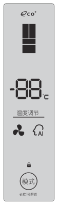

###### ◆锁定与解锁 

按键锁定时，每次按键时，蜂鸣器响一声，锁图标闪烁一次。按住模式键（解锁键）约3秒以上，蜂鸣器响一声，锁图标 熄灭，按键解锁。解锁后，无任何按键操作约20秒后自动上锁，锁定图标点亮，冷藏与冷冻设定温度按3秒间隔循环显示，约1分钟 后LED屏熄灭。 

◆温度设定步骤 

冷藏室温度的设定 

在解锁状态下，按温度调节键，冷藏温度可在8℃~2℃间连续循环调节，每次按键从当前设定值起，按“5→4→3→2→8→7→6”在温度 显示区显示冷藏温度设定值，调温时温区选择上面两排指示灯（冷藏）闪烁、下面两排指示灯（冷冻）常亮。 ◆模式功能 

每次按模式键从当前模式（如无，则从智能开始）起，按“智能、速冷”顺序切换，相应图标闪烁点亮，去掉假日和速冻模式 

1）智能模式下，冷藏室设定温度为5℃。 

- 2）速冷模式下，冷藏室设定为2℃、速冷模式工作时间为3小时， 3小时退出速冷模式后，自动恢复到之前的模式。 

- 23 - 

###### <mark>LED触摸屏操作键功能说明</mark> 

速冷图标（蓝光雾灯） 

速冻图标（蓝光雾灯） 

###### 温度设置 

冷藏温度设置：短按“冷藏”按键，冷藏温度可在8℃~2℃间循环调节，在冷藏温度显示区显示冷藏设定温度值。指示灯点亮指示对应的温度设定值。每次 冷藏设定调节范围为： 

冷冻温度设置：短按“冷冻”按键，冷冻温度可在-16℃～-24℃间循环调节，在冷冻温度显示区显示冷冻设定温度值。指示灯点亮指示对应的温度设定值。 冷冻设定调节范围为： 

2 <mark>℃</mark> 3 <mark>℃</mark> 4 <mark>℃</mark> 6 <mark>℃</mark> 8 <mark>℃</mark> -16 <mark>℃</mark> -18 <mark>℃</mark> -20 <mark>℃</mark> -22 <mark>℃</mark> -24 <mark>℃</mark> （冷藏温度设定） （冷冻温度设定） 

上述冰箱设定调节操作时，相应温度值闪烁，原闪烁内容停闪。连续5秒无按键操作后，停止闪烁并设置生效（按新设定发送数据）。 模式功能 

1.速冻模式 

长按“冷冻按键3秒，可进入速冻模式。当进行冷冻调温操作或进入速冻模式26小时后，自动退出速冻模式。速冻模式时，显示    速冻图标及-24℃指示灯 点亮。 

退出速冻模式后，自动按原有冷冻设定温度运行。 

2.速冷模式 

长按“冷藏”按键3秒，可进入速冷模式。当进行冷藏调温操作或进入速冷模式6小时后，自动退出速冷模式。当进入速冷模式时，显示    速冻图标及2℃ 指示灯点亮。 

退出速冷模式后，自动按原有冷藏设定温度运行。 

3.断电记忆 

断电记忆以下设定：冷藏设定温度、冷冻设定温度。重新上电后，冰箱会自动按断电前原有设定运行，不记忆速冷、速冻模式。 

- 24 - 

###### <mark>温度调节</mark> 

- 1.您可以根据需要调节位于冷藏室顶部温控器旋钮的位置，对箱内温度进行调节。温控器将根据用户所调节的档位自动控制箱内温度在一定范围内。 

- 2.调温旋钮上的数字是温控器的档位，不代表具体温度值。温控器前端数字“0”档代表停机，“7”档在特殊情况下（高温环境）会出现长期运转状态， 

- “1-7”档代表开机制冷，数字越大箱内温度越低。夏天宜将旋钮调在“2-4”，冬天宜将旋钮调在“4-6”，一般使用调在“3-4”为宜。 

- 3.接水盘主要防止蒸发器化水滴落到冷藏室食品上，并注意接水盘应定期倒水，接水盘内不能盛装冷藏食品。 

- 4.冷藏箱化霜是半自动进行，只要按一下灰色按钮，蒸发器就会自动化霜，化霜水滴落到接水盘上。 

- 5.当环境温度接近或低于10℃ `，` 冷藏冷冻箱应打开开关拨到“ON”(开） `，` 当环境温度高于15℃ `，` 应关闭温度补偿开关，将温控罩补偿开关拨到“OFF”(关）， 如不关闭，耗电量大幅度增加的同时，还会造成不停机，甚至会造成其它更为严重的故障（适用于有图示四装置的所有冰箱)。 

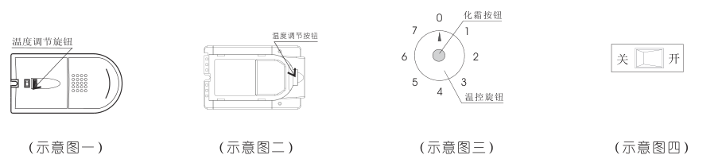

<!-- Start of picture text -->
0 化霜按钮 7 1 6 2 关 开 5 3 4 温控旋钮 （示意图一） （示意图二） （示意图三） （示意图四） <!-- End of picture text -->

注意：冬季环境温度较低时，自动温度补偿开关将自动开启。当环境温度较高时，则自动关闭。 注意：“7”档适于速冻或储存大量食品，速冻后应及时将旋钮回复到正常状态，一般情况不选择此档，以免冻坏食物。 冰箱第一次开机。因需要从环境温度降至冰箱停机温度， 所以开机时间较长。 

- 25- 

###### <mark>间室使用说明</mark> 

- **1.循环风扇：冷藏箱内设置直流循环风扇，使冷藏温度更均匀 2.冷藏室储藏不需要冻结的食品和饮料。需短期储藏的食品或随时要吃的菜请放于冷藏室。 3.蔬菜保鲜时首先甩干蔬菜表面的水份，否则果菜盒里充满水份，会加速蔬菜的腐烂。 4.热的食品放入冷藏室前必须先冷却至室温。** 

**5.存放食物时，要留有适当的空隙、否则会影响冷气循环。 6.食品分小包装按类存放，可方便存取、避免不必要的长时间开门，从而达到节能目的。** 

**7.香蕉、甜瓜、菠萝等温热带水果不适合长时间冷藏储存。** 

- 26 - 

###### <mark>间室使用说明</mark> 

- **1.冷冻室用于冷冻食品和制取少量冰块、雪糕等，要长时间冷冻保存的食品应放在这个间室储藏。** 

- **2.购买速冻食品后，要在食品尚未解冻的状态下，尽快将其置于冷冻室内进行冷冻储存。** 

- **3.热的食品放入冷冻室前必须冷却至室温。** 

- **4.冷冻室内配有抽屉，用于存放食品，用户也可将食品直接放于蒸发器搁架上。** 

- **5.存放食物时，要留有适当的空隙，否则会影响冷气循环。** 

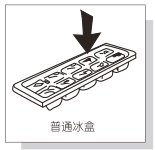

<!-- Start of picture text -->
普通冰盒 <!-- End of picture text -->

- **6.食品分小包装按类存放，可方便存取、避免不必要的长时间开门，从而达到节能的目的，而且不易风干或串味。** 

- **7.蛋类、生叶类蔬菜、生薯类、乳制品、豆制品类不适合冷冻保存。** 

- **8.熟食和生食应分开存放。** 

- **9.冰盒用于制取冰块，注入五分之四的凉开水，置于冷冻室，待冰盒中的水结成实冰后，只需扭动冰盒就可使冰块和冰盒分离。但切 勿折弯冰盒，以免断裂。** 

###### **关于变温室** 

- **1.变温室软冻、冷冻温区转换制开关位于温控盒上。** 

- **2.当将转换开关至 ON标记，变温室温度逐渐降至冷冻温区，变温室作为冷冻室使用。** 

- **3.当将转换开关至 OFF标记，变温室温度逐渐上升至软冻温区，变温室作为软冻室使用。** 

- **4.当变温室温区从冷冻温区转换至软冻温区，或从软冻温区转至冷冻温区将有一段过度时间。** 

- **5.当变温室温度从冷冻温区转至软冻温区时，最好将食品取出，否则将延长温区转换时间。** 

**注意:不宜存放冰棒、雪糕、冰淇淋等需要冷冻保存的食品 注意:热的食物最好冷却到室温再放入间室 注意:不宜存放瓜果蔬菜及蛋类食品 注意:不宜存放玻璃包装的饮料等** 

- 27 - 

###### <mark>除霜及灯更换</mark> 

###### **关于保鲜室、软冻室** 

- **1.适合新鲜肉类、鱼虾和海鲜类食品的短期保鲜存储及冷冻食品的解冻；** 

- **2.建议冷冻类食品在食用前先放入该室内进行解冻，使食品营养不流失（解冻时间一至两天）；** 

- **3.可存储熟食，实现生熟食品分类储存，干净卫生，使用放心；** 

###### 除霜 

- 冷冻室需人工除霜，冰箱使用一段时间后，冷冻室蒸发器上会形成一层霜，会影响制冷效果。因此，霜层达到5mm以上时，应及时除霜。 1.除霜时，取出冷冻室内冻结食品，并适当包裹，放到阴凉处； 2.取出冷冻室内全部附件，将温度控制在“0”档（或直接切断电源），并打开冷冻室门。（若要加速除霜，可在冷冻室内放一碗约50℃的温水）； 

- 3.用干净的软布擦净残留冰水，然后将食物重新放入冰箱，接通电源，开机制冷； 

- 4.无霜冷藏冷冻箱会按一定运行周期自动化霜，无需人工化霜； 

切勿用尖锐锋利的器具或用电吹风直接加热，以免对冷冻室壁面造成损坏。 

除了制造商推荐的方式外，不得使用机械设备或其他方式加速除霜过程。 

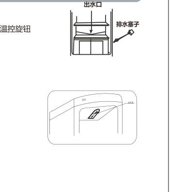

冷藏室一般为自动化霜，化霜水通过背部下端的出水口随时排出，并利用压缩机热量自动蒸发。 由于温控档位过大或使用不当，或造成冷藏室结霜，如果发现冷藏室背部有较厚的霜层，影响制冷效果时，需除霜。姜温控旋钮 调至“ 0”档，待霜化完后，再将温控旋钮调回原状态。 

###### 箱内灯更换 

- 1.普通灯（220V/240V,10W） 

   - 2.LED灯（12V,1.5W/2W） 

   - 若箱内照明LED灯发现故障，请勿擅自拆开和安装， 需要专业维修人员维修和安装，请与本公司售后服 务联系。 

- 首先拔下电源插头，用力往外抽出灯罩，逆时针 

- 旋出旧灯泡，换上新灯泡，最后将温控罩托上即可 

- 28 - 

# <u><mark>a</mark></u> <mark>零部件的使用</mark> 

- 29 - 

### ~~<mark>i</mark>~~ <mark>清洁</mark> 

- 30  - 

###### <mark>冰箱停用</mark> 

- 31 - 

###### <mark>故障判定</mark> 

|现象|查看|现象|查看|
|---|---|---|---|
|冰箱不工作|电源是否接通，电压是否过低，插头是否插牢|异常噪声|压缩机上的接水盘是否脱落|
||温控器旋钮是否在`“0”`档位||压缩机室内制冷管路是否互碰|
|制冷效果差|温控器旋钮上的档位数字是否调的太小|冰箱异味|有气味的食物是否密封保存|
||食品是否放置过多、过于拥挤||是否有变质的食品|
||是否放入热的食品过多||冰箱内部是否需要清洁|
||门的关闭是否过于频繁|冬天不开机|环境温度过低，应打开温度补偿开关|
||冰箱是否受日光直射过近处有热源||是否放入热的食品过多|
||冰箱周围有无散热空间|夏天高温不停机|温控器旋钮上的档位数字是否调得太大|
||箱门是否未关好或门封条有损伤、变形||门的开闭是否过于频繁|
|冷藏室食品被冻结|温控器旋钮上的档位数字是否调的太大||箱门是否未关好或门封条有损伤、变形|
||是否含水量较多的食物太靠近后壁||冰箱外部通风不良，冷凝器散热不充分|
|异常噪声|冰箱是否碰到墙壁或其他物体|化霜水流于箱内或地面上|排水孔是否堵塞|
||地面是否平坦，冰箱放置是否平稳||压缩机的接水盘安置的位置是否适当|
||冰箱附件是否放在正确位置|||

- 32 - 

###### <mark>非故障判断</mark> 

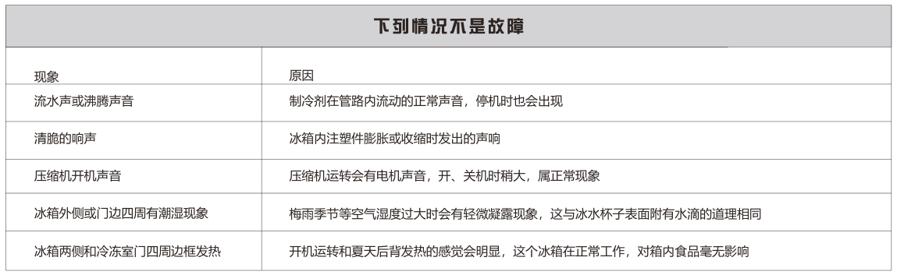

<!-- Start of picture text -->
现象 原 因 流水声或沸腾声音 制冷剂在管路内流动的正常声音，停机时也会出现 清脆的响声 冰箱内注塑件膨胀或收缩时发出的声响 压缩机开机声音 压缩机运转会有电机声音，开、关机时稍大，属正常现象 冰箱外侧或门边四周有潮湿现象 梅雨季节等空气湿度过大时会有轻微凝露现象，这与冰水杯子表面附有水滴的道理相同 冰箱两侧和冷冻室门四周边框发热 开机运转和夏天后背发热的感觉会明显，这个冰箱在正常工作，对箱内食品毫无影响 <!-- End of picture text -->

- 注 1.冰箱使用的电源必须与铭牌上标定的电源一致，并单独使用标准三孔插座（10A以上），插座必须接地。 

- 意 2.插头一定要保持清洁，安全插入到底，不易脱落。插拔电源时要手持插头。切勿使冰箱挤压插头；切勿损伤电源线，也不要让电源线贴近压缩机以免 绝缘失效；切勿使用损伤的电源线、插头和插座。 

   - 3.易挥发易燃的喷雾器容易引起火灾，要远离冰箱。电冰箱内严禁放入易燃易爆的危险品，以及腐蚀性的酸碱等。 

   - 4.使用过程中，如发现麻电、异常声响、气味、冒烟等异常现象时，请切断电源停止使用，并及时与本公司指定的维修服务部联系。 

   - 5.禁止使冰箱本体遇水，切勿将装有水的容器放在冰箱上，一旦打碎，则会影响冰箱电气绝缘性能，导致触电或火灾。 

   - 6.禁止将重物吊在门上或骑在拉开的门上，否则会造成冰箱翻倒或物品掉落等危险，儿童要特别注意！ 

   - 7.切勿在冷冻室内保存玻璃瓶装液体食品，以防容器冻裂而导致割伤手指。切勿用湿手触摸冷冻室内食品和容器（特别是金属容器），防止冻伤手指。 8.切勿擅自拆卸、修理和改造。 

   - 9.停电后，请拔下电源插头，至少等5分钟后，方可重新接通电源。 

   - 10.冰箱顶部不要放置重物，也不要放置热水壶，电炉、调压器、点燃的蜡烛等加热器具。 

   - 11.当煤气泄露时，不要触动冰箱，要先关好气阀，开窗排换空气；若马上拔掉电源插头或转动调温旋钮会发生打火现象。 

   - 12.冰箱禁止在户外和雨中使用。 

- 33 - 

###### <mark>回收信息</mark> 

本产品超过使用期限或经过维修无法正常工作后，不应随意丢弃，请交由有废弃电器电子产品处理资格的企业处理，正确的处理方法请查阅国家或 当地有关旧电器电子产品处理的规定。 

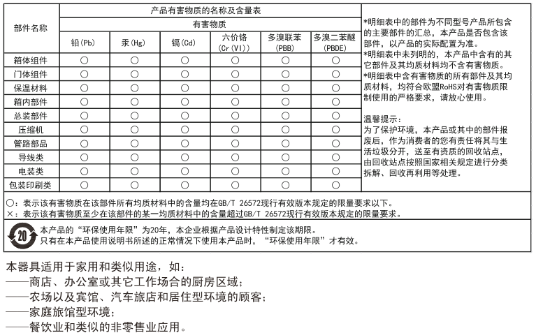

- 34 - 

###### <mark>规格参数</mark> （冷藏系列） 

|名称 型号|防触电保 护类别|发泡剂 |气候类型|总容积 冷|容 冻室|积（`L`）   冷藏室|其他间室|电源|额定电 流（`A`）|能效 等级|标准耗电量 `(kW h/24h)`|年耗电量 `(kW h/y)`|冷却能力 `(kg/12h)`|制冷剂/ 灌注量`(g)`|噪音 `dB(A)` 重量 `kg` `(` `)`|产品尺寸 (宽*深*高)(mm)|
|---|---|---|---|---|---|---|---|---|---|---|---|---|---|---|---|---|
|BC-48|I|环戊烷|SN/N/ST|48|/|48|/|220V~/50Hz|0.55|2|0.35|128|4.0|R600a/19g|37 13|450X475X506|
|BC-50A|I|环戊烷|SN/N/ST|50|/|50|/|220V~/50Hz|0.55|2|0.35|128|4.0|R600a/12g|37 11|385X380X483|
|BC-50|I|环戊烷|SN/N/ST|50|/|50|/|220V~/50Hz|0.55|2|0.35|128|4.0|R600a/19g|37 13|450X475X506|
|BC-70P95L|I|环戊烷|SN/N/ST|70|/|70|/|220V~/50Hz|0.55|2|0.36|131|6.0|R600a/20g|37 16|450X475X681|
|BC-21K50L|I|环戊烷|SN/N/ST|21|/|21|/|220V~/50Hz|0.55|2|0.34|124|2.0|R600a/8g|37 10|385X380X483|
|BC-21A|I|环戊烷|SN/N/ST|21|/|21|/|220V~/50Hz|0.55|2|0.34|124|2.0|R600a/8g|37 10|385X380X483|
|BC-22K68L|I|环戊烷|SN/N/ST|22|/|22|/|220V~/50Hz|0.55|2|0.34|124|2.0|R600a/8g|37 10|385X380X483|
|BC-50P80L|I|环戊烷|SN/N/ST|50|/|50|/|220V~/50Hz|0.55|2|0.35|128|4.0|R600a/19g|37 13|450X475X506|
|BC-70P128L|I|环戊烷|SN/N/ST|70|/|70|/|220V~/50Hz|0.55|2|0.36|131|6.0|R600a/20g|37 16|450X475X681|
|BC-95K1AR|I|环戊烷|SN/N/ST|95|/|80|15|220V~/50Hz|0.55|2|0.43|157|6.0|R600a/28g|42 30|506X574X871|
|BC-105K1AW|I|环戊烷|SN/N/ST|105|/|105|/|220V~/50Hz|0.55|2|0.37|135|6.0|R600a/26g|42 30|506X574X871|
|BC-225K1AR|I|环戊烷|SN/N/ST|225|/|208|17|220V~/50Hz|0.55|2|0.56|204|17.0|R600a/38g|42 47|546X626X1456|
|BC-150K1AL|I|环戊烷|SN/N/ST|150|/|125|25|220V~/50Hz|0.55|2|0.42|153|6.0|R600a/59g|42 33|523X533X1177|
|BC-176K1AR|I|环戊烷|SN/N/ST|176|/|151|25|220V~/50Hz|0.55|2|0.44|161|6.0|R600a/60g|42 35|525X533X1297|
|BC-91K1AW|I|环戊烷|SN/N/ST|91|/|91|`/`|220V~/50Hz|0.55|2|0.36|131|6.0|R600a/24g|42 22|448X508X874|
|BC-38Q98|I|环戊烷|SN/N/ST|38|/|38|`/`|220V~/50Hz|0.55|1|0.28|102|2.0|R600a/8g|37 10|385X380X483|

- 35 - 

###### <mark>规格参数</mark> （二门系列-渠道 ） 

|名称 型号|防触电保 护类别|发泡剂 | 气候类型|总容积|容积 冷冻室|（`L`）  冷藏室其|他间室|电源|化霜功 率`(W)`|额定电 流（`A`）|能效 等级  `(`|标准耗电量 `kW h/24h)`| 综合耗电量 `(kW h/24h)`|年耗电量 `(kW h/y)`|冷却能力 `(kg/12h)`|冷冻能力 `(kg/12h`|`)` 制冷剂/ 灌注量`(g)`|噪音 `dB(A)`|`(`|重 `k` |量 `g` `)`|产品尺寸 (宽*深*高)(mm)|
|---|---|---|---|---|---|---|---|---|---|---|---|---|---|---|---|---|---|---|---|---|---|---|
|BCD-118A|I|环戊烷|SN/N/ST|118|42|76|/|220V~ 50Hz|/ |0.56|3|0.51|0.55|201|6.0|1.5|R600a/22g|37||1|5|385X380X783|
|BCD-128A|I|环戊烷|SN/N/ST|128|32|96|/|220V~ 50Hz |/  |0.56|3|0.52|0.56|204|8.0|1.0|R600a/24g|37||1|6|385X380X983|
|BCD-95D|I|环戊烷|SN/N/ST|95|32|63|/|220V~ 50Hz |/  |0.56|2|0.34|0.37|135|5.0|1.0|R600a/26g|37||1|8|425X435X830|
|BCD-115H|I|环戊烷|SN/N/ST|115|30|85|/|220V~ 50Hz|/ |0.56|2|0.35|0.38|139|7.0|1.0|R600a/27g|37||1|9|430X440X1000|
|BCD-135CB|I|环戊烷|SN/N/ST|135|42|93|/|220V~ 50Hz|/ |0.68|2|0.37|0.40|146|7.5|1.5|R600a/34g|37||2|5|450X522X1135|
|BCD-160CB|I|环戊烷|SN/N/ST|160|49|111|/|220V~ 50Hz|/ |0.68|2|0.40|0.43|157|9.0|1.5|R600a/38g|37||3|1|450X542X1220|
|BCD-180B|I|环戊烷|SN/N/ST|180|66|114|/|220V~ 50Hz|/ |0.68|2|0.42|0.45|164|9.0|2.0|R600a/43g|38||3|5|476X548X1400|
|BCD-180BP|I|环戊烷|SN/N/ST|180|66|114|/|220V~ 50Hz|/ |0.68|2|0.42|0.45|164|9.0|2.0|R600a/43g|38||3|5|510X548X1400|
|BCD-159Y|I|环戊烷|SN/N/ST|159|59|100|/|220V~ 50Hz|/ |0.68|1|0.30|0.32|117|8.0|2.0|R600a/43g|38||2|9|475X520X1210|
|BCD-178Y|I|环戊烷|SN/N/ST|178|60|118|/|220V~ 50Hz|/ |0.68|1|0.31|0.33|120|9.0|2.0|R600a/47g|38||3|0|475X520X1325|
|BCD-196CNP|I|环戊烷|SN/N/ST|196|74|122|/|220V~ 50Hz|/ |0.68|1|0.31|0.33|120|10.0|2.0|R600a/56g|38||4|6|540X585X1531|
|BCD-100D|I|环戊烷|SN/N/ST|100|33|67|/|220V~ 50Hz|/ |0.56|2|0.34|0.37|135|5.0|1.0|R600a/26g|37||1|8|425X435X830|
|BCD-100S|I|环戊烷|SN/N/ST|100|33|67|/|220V~ 50Hz|/ |0.56|2|0.34|0.37|135|5.0|1.0|R600a/26g|37||1|8|425X435X830|
|BCD-115S|I|环戊烷|SN/N/ST|115|30|85|/|220V~ 50Hz|/ |0.56|2|0.35|0.38|139|7.0|1.0|R600a/27g|37||1|9|430X440X1000|
|BCD-115Q|I|环戊烷|SN/N/ST|115|30|85|/|220V~ 50Hz|/ |0.56|2|0.35|0.38|139|7.0|1.0|R600a/27g|37||1|9|430X440X1000|
|BCD-158CB|I|环戊烷|SN/N/ST|158|48|110|/|220V~ 50Hz|/ |0.68|2|0.40|0.43|157|9.0|1.5|R600a/38g|37||3|1|450X542X1220|
|BCD-158A|I|环戊烷|SN/N/ST|158|48|110|/|220V~ 50Hz|/ |0.68|2|0.40|0.43|157|9.0|1.5|R600a/38g|37||3|1|450X542X1220|
|BCD-198CM|I|环戊烷|SN/N/ST|198|65|133|/|220V~ 50Hz|/ |0.68|1|0.31|0.33|120|11.0|2.0|R600a/42g|38||3|6|476X548X1519|
|BCD-102CB|I|环戊烷|SN/N/ST|102|30|72|/|220V~ 50Hz|/ |0.56|2|0.35|0.38|138|6.0|1.0|R600a/30g|37||2|1|450X520X835|
|BCD-116CB|I|环戊烷|SN/N/ST|116|26|90|/|220V~ 50Hz|/ |0.56|2|0.36|0.39|142|7.0|1.0|R600a/30g|37||2|3|450X520X1013|
|BCD-171Q196|I|环戊烷|SN/N/ST|171|66|105|/|220V~ 50Hz|/ |0.68|1|0.31|0.33|120|10.0|2.0|R600a/56g|38||4|6|540X585X1531|
|BCD-52Q95|I|环戊烷|SN/N/ST|52|18|34|/|220V~ 50Hz|/ |0.56|2|0.31|0.33|120|3.0|1.0|R600a/26g|37||1|8|425X435X830|
|BCD-109Q135|I|环戊烷|SN/N/ST|109|34|75|/|220V~ 50Hz|/ |0.68|2|0.36|0.39|142|7.5|1.5|R600a/34g|37||2|5|450X522X1135|
|BCD-122Q160|I|环戊烷|SN/N/ST|122|37|85|/|220V~ 50Hz|/ |0.68|2|0.37|0.40|146|9.0|1.5|R600a/38g|37||3|1|450X542X1220|
|BCD-129Q159|I|环戊烷|SN/N/ST|129|50|79|/|220V~ 50Hz|/ |0.68|1|0.28|0.30|110|6.0|2.0|R600a/43g|38||2|9|475X520X1210|
|BCD-150Q178|I|环戊烷|SN/N/ST|150|50|100|/|220V~ 50Hz|/ |0.68|1|0.29|0.31|113|8.0|2.0|R600a/47g|38||3|0|475X520X1325|
|BCD-152Q180|I|环戊烷|SN/N/ST|152|56|96|/|220V~ 50Hz|/|0.68|2|0.41|0.44|161|9.0|2.0|R600a/43g|38||3|5|476X548X1400 510X548X1400|
|BCD-168CB|I|环戊烷|SN/N/ST|168|62|106|/|220V~ 50Hz|/|0.68|2|0.41|0.44|162|8.5|2.0|R600a/38g|38||3|3|476X552X1295 510X552X1295|
|BCD-180CB|I|环戊烷|SN/N/ST|180|62|118|/|220V~ 50Hz|/|0.68|2|0.42|0.45|164|9.0|2.0|R600a/43g|38||3|5|476X548X1400 510X548X1400|
|BCD-168DK|I|环戊烷|SN/N/ST|168|62|106|/|220V~ 50Hz|/|0.68|2|0.41|0.44|161|8.5|2.0|R600a/38g|38||3|3|476X552X1295 510X552X1295|
|BCD-50Q128|I|环戊烷|SN/N/ST|50|12|38|/|220V~ 50Hz|/ |0.56|3|0.42|0.45|164|2.5|1.0|R600a/24g|37||1|6|385X380X983|
|BCD-68Q115|I|环戊烷|SN/N/ST|68|18|50|/|220V~ 50Hz|/ |0.56|2|0.32|0.35|128|4.0|1.0|R600a/27g|37||1|9|430X440X1000|

- 36 - 

###### <mark>规格参数</mark> （二门系列-渠道 ） 

|名称 型号|防触电保 护类别|发泡剂 |气候类型|总容积|容积  冷冻室|（） `L` 冷藏室 其他间室|电源|化霜功 率`(W)`  |额定电 流（） `A`|能效 等级|标准耗电量 `(kW h/24h)`|综合耗电量 `(kW h/24h)`|年耗电量 `(kW h/y)`|冷却能力 `(kg/12h)`|冷冻能力 `(kg/12h`|`)` 制冷剂`/` 灌注量`(g)`|噪音 `dB(A)`|重 `k` `(`|量 `g` `)`  产品尺寸 `(`宽*深*高`)(`mm`)`|
|---|---|---|---|---|---|---|---|---|---|---|---|---|---|---|---|---|---|---|---|
|BCD-118C|I|环戊烷|SN/N/ST|118|48|70 /|2 2 0 V ~ 5 0 H z|/ |0.56|2|0.37|0.40|146|7.0|1.0|R600a/35g|37|1|6 385 415 1005 X X|
|BCD-70K120|I|环戊烷|SN/N/ST|70|28|42 /|2 2 0 V ~ 5 0 H z|/ |0.56|2|0.32|0.35|128|4.5|1.0|R600a/35g|37|1|6 385 415 1005 X X|
|BCD-128C|I|环戊烷|SN/N/ST|128|45|83 /|2 2 0 V ~ 5 0 H z |/   |0.68|2|0.38|0.42|153|7.0|1.0|R600a/45g|37|2|2 425 512 1110 X X|
|BCD-110K130|I|环戊烷|SN/N/ST|110|38|72 /|2 2 0 V ~ 5 0 H z|/ |0.68|2|0.36|0.40|146|7.0|1.0|R600a/45g|37|2|2 425 512 1110 X X|
|BCD-150C|I|环戊烷|SN/N/ST|150|54|96 /|2 2 0 V ~ 5 0 H z|/ |0.68|2|0.40|0.44|161|8.0|1.5|R600a/38g|37|2|5 425 512 1310 X X|
|BCD-128K150|I|环戊烷|SN/N/ST|128|46|82 /|2 2 0 V ~ 5 0 H z|/ |0.68|2|0.38|0.42|153|8.0|1.5|R600a/38g|37|2|5 425 512 1310 X X|
|BCD-170C|I|环戊烷|SN/N/ST|170|52|118 /|2 2 0 V ~ 5 0 H z|/ |0.68|2|0.42|0.46|168|9.0|1.5|R600a/42g|37|2|8 425 512 1470 X X|
|BCD-149K170|I|环戊烷|SN/N/ST|149|46|103 /|2 2 0 V ~ 5 0 H z|/ |0.68|2|0.39|0.43|157|9.0|1.5|R600a/42g|37|2|8 425 512 1470 X X|
|BCD-69Q116|I|环戊烷|SN/N/ST|69|28|41 /|2 2 0 V ~ 5 0 H z|/ |0.56|2|0.32|0.35|128|4.5|1.0|R600a/35g|37|1|6 385 415 1005 X X|
|BCD-79Q126|I|环戊烷|SN/N/ST|79|28|51 /|2 2 0 V ~ 5 0 H z|/ |0.56|2|0.33|0.36|131|5.0|1.0|R600a/38g|37|1|8 385 415 1115 X X|
|BCD-89Q146|I|环戊烷|SN/N/ST|89|28|61 /|2 2 0 V ~ 5 0 H z|/ |0.56|2|0.34|0.37|135|5.5|1.0|R600a/39g|37|1|9 385 415 1215 X X|
|BCD-110Q136|I|环戊烷|SN/N/ST|110|38|72 /|2 2 0 V ~ 5 0 H z|/ |0.68|2|0.36|0.40|146|7.0|1.0|R600a/45g|37|2|2 425 512 1110 X X|
|BCD-128Q166|I|环戊烷|SN/N/ST|128|46|82 /|2 2 0 V ~ 5 0 H z|/ |0.68|2|0.38|0.42|153|8.0|1.5|R600a/38g|37|2|5 425 512 1310 X X|
|BCD-149Q176|I|环戊烷|SN/N/ST|149|46|103 /| 2 2 0 V ~ 5 0 H z|/ |0.68|2|0.39|0.43|157|9.0|1.5|R600a/42g|37|2|8 425 512 1470 X X|
|BCD-169Q186|I|环戊烷|SN/N/ST|169|66|103 /|2 2 0 V ~ 5 0 H z|/ |0.68|2|0.43|0.47|172|9.0|2.0|R600a/50g|37|3|1 425 512 1640 X X|
|BCD-120|I|环戊烷|SN/N/ST|120|49|71 /|2 2 0 V ~ 5 0 H z|/ |0.56|2|0.38|0.41|150|7.0|1.0|R600a/35g|37|1|6 385 415 1005 X X|
|BCD-130|I|环戊烷|SN/N/ST|130|46|84 /|2 2 0 V ~ 5 0 H z|/ |0.56|2|0.38|0.41|150|8.0|1.0|R600a/38g|37|1|8 385 415 1115 X X|
|BCD-150|I|环戊烷|SN/N/ST|150|54|96 /|2 2 0 V ~ 5 0 H z|/ |0.56|2|0.40|0.44|161|8.0|1.5|R600a/39g|37|1|9 385 415 1215 X X|
|BCD-140|I|环戊烷|SN/N/ST|140|48|92 /|2 2 0 V ~ 5 0 H z|/ |0.68|2|0.39|0.43|157|8.0|1.5|R600a/45g|37|2|2 425 512 1110 X X|
|BCD-170|I|环戊烷|SN/N/ST|170|61|109 /| 2 2 0 V ~ 5 0 H z|/ |0.68|2|0.42|0.46|168|9.0|2.0|R600a/38g|37|2|5 425 512 1310 X X|
|BCD-180|I|环戊烷|SN/N/ST|180|56|124 /|2 2 0 V ~ 5 0 H z|/ |0.68|2|0.43|0.47|172|10.0|2.0|R600a/42g|37|2|8 425 512 1470 X X|
|BCD-190|I|环戊烷|SN/N/ST|190|74|116 /|2 2 0 V ~ 5 0 H z|/ |0.68|2|0.45|0.49|179|10.0|2.5|R600a/50g|37|3|1 425 512 1640 X X|
|BCD-70K178|I|环戊烷|SN/N/ST|70|28|42 /|2 2 0 V ~ 5 0 H z|/ |0.56|1|0.23|0.26|95|4.5|1.0|R600a/35g|37|1|6 385 415 1005 X X|
|BCD-98K178|I|环戊烷|SN/N/ST|98|40|58 /|2 2 0 V ~ 5 0 H z|/ |0.56|1|0.25|0.28|102|4.5|1.0|R600a/35g|37|1|6 385 415 1005 X X|
|BCD-80K188|I|环戊烷|SN/N/ST|80|28|52 /|2 2 0 V ~ 5 0 H z|/ |0.56|1|0.23|0.26|95|5.0|1.0|R600a/38g|37|1|8 385 415 1115 X X|
|BCD-108K188|I|环戊烷|SN/N/ST|108|38|70 /|2 2 0 V ~ 5 0 H z|/ |0.56|1|0.25|0.28|102|5.0|1.0|R600a/38g|37|1|8 385 415 1115 X X|
|BCD-90K198|I|环戊烷|SN/N/ST|90|28|62 /|2 2 0 V ~ 5 0 H z|/ |0.56|1|0.24|0.27|99|5.5|1.0|R600a/39g|37|1|9 385 415 1215 X X|
|BCD-118K198|I|环戊烷|SN/N/ST|118|36|82 /|2 2 0 V ~ 5 0 H z|/ |0.56|1|0.26|0.29|106|5.5|1.0|R600a/39g|37|1|9 385 415 1215 X X|
|BCD-109K218|I|环戊烷|SN/N/ST|109|37|72 /|2 2 0 V ~ 5 0 H z|/ |0.68|1|0.25|0.28|102|7.0|1.0|R600a/45g|37|2|2 425 512 1110 X X|
|BCD-128K218|I|环戊烷|SN/N/ST|128|43|85 /| 2 2 0 V ~ 5 0 H z|/ |0.68|1|0.27|0.30|110|7.0|1.0|R600a/45g|37|2|2 425 512 1110 X X|
|BCD-148K238|I|环戊烷|SN/N/ST|148|45|103 /|2 2 0 V ~ 5 0 H z|/ |0.68|1|0.28|0.31|113|9.0|2.0|R600a/42g|37|2|8 425 512 1470 X X|
|BCD-178K238|I|环戊烷|SN/N/ST|178|54|124 /|2 2 0 V ~ 5 0 H z|/ |0.68|1|0.30|0.33|120|10.0|2.0|R600a/42g|37|2|8 425 512 1470 X X|
|BCD-168Q258|I|环戊烷|SN/N/ST|168|64|104 /|2 2 0 V ~ 5 0 H z|/ |0.68|1|0.30|0.33|120|9.0|2.0|R600a/50g|37|3|1 425 512 1640 X X|

- 37 - 

###### <mark>规格参数</mark> （二门系列-渠道 ） 

|名称 |防触电保||||容积|（） `L`|||化霜功|额定电 |能效  标准耗电量 |综合耗电量 |年耗电量 |冷却能力 |冷冻能力 |制冷剂`/` |噪音 |重 |量   产品尺寸|
|---|---|---|---|---|---|---|---|---|---|---|---|---|---|---|---|---|---|---|---|
|型号|护类别|发泡剂|气候类型|总容积|冷冻室|冷藏室 |其他间室|电源|率`(W)`|流（） `A`|等级 `(kW h/24h)`|`(kW h/24h)`|`(kW h/y)`|`(kg/12h)`|`(kg/12h)`|灌注量`(g)`|`dB(A)`|`kg` `(`|`)` `(`宽*深*高`)(`mm`)`|
|BCD-128K228|I|环戊烷|SN/N/ST|128|46|82|/|2 2 0 V ~ 5 0 H z|/|0.68|1 0.27|0.30|110|8.0|1.5|R600a/38g|37|25|425 512 1310 X X|
|BCD-158K228|I|环戊烷|SN/N/ST|158|56|102|/|2 2 0 V ~ 5 0 H z|/|0.68|1 0.29|0.32|117|9.0|2.0|R600a/38g|37|25|425 512 1310 X X|
|BCD-116|I|环戊烷|SN/N/ST|116|48|68|/|2 2 0 V ~ 5 0 H z|/|0.56|2 0.37|0.40|146|7.0|1.0|R600a/35g|37|16|385 415 1005 X X|
|BCD-126|I|环戊烷|SN/N/ST|126|45|81|/|2 2 0 V ~ 5 0 H z|/|0.56|2 0.38|0.41|150|8.0|1.0|R600a/38g|37|18|385 415 1115 X X|
|BCD-146|I|环戊烷|SN/N/ST|146|46|100|/|2 2 0 V ~ 5 0 H z|/|0.56|2 0.39|0.43|157|8.0|1.5|R600a/39g|37|19|385 415 1215 X X|
|BCD-136|I|环戊烷|SN/N/ST|136|47|89|/|2 2 0 V ~ 5 0 H z|/|0.68|2 0.39|0.43|157|8.0|1.5|R600a/45g|37|22|425 512 1110 X X|
|BCD-166|I|环戊烷|SN/N/ST|166|60|106|/|2 2 0 V ~ 5 0 H z|/|0.68|2 0.42|0.46|168|9.0|2.0|R600a/38g|37|25|425 512 1310 X X|
|BCD-176|I|环戊烷|SN/N/ST|176|54|122|/|2 2 0 V ~ 5 0 H z|/|0.68|2 0.42|0.46|168|10.0|2.0|R600a/42g|37|28|425 512 1470 X X|
|BCD-186|I|环戊烷|SN/N/ST|186|73|113|/|2 2 0 V ~ 5 0 H z|/|0.68|2 0.44|0.48|175|10.0|2.5|R600a/50g|37|31|425 512 1640 X X|
|BCD-208Q258|I|环戊烷|SN/N/ST|208|80|128|/|2 2 0 V ~ 5 0 H z|/|0.68|1 0.33|0.36|131|9.0|2.0|R600a/50g|37|31|425 512 1640 X X|

- 38 - 

###### <mark>规格参数</mark> （三门/四门系列-渠道） 

|名称 型号|防触电保 护类别|发泡剂 | 气候类型|总容积|容积 冷冻室|（`L`）  冷藏室|其他间室|电源 |额定电 流（`A`）|能效 等级 标准耗电量 `(kW h/24h)`|综合耗电量 `(kW h/24h)`|年耗电量 `(kW h/y)`|冷却能力 `(kg/12h)`|冷冻能力 `(kg/12h)`|制冷剂/ 灌注量`(g)`  |噪音 `dB(A)`|重量 `kg` `(` `)` 产品尺寸 (宽*深*高)(mm)|
|---|---|---|---|---|---|---|---|---|---|---|---|---|---|---|---|---|---|
|BCD-45Q122|I|环戊烷|SN/N/ST|45|12|23|10|220V~/50Hz|0.68|3 0.42|0.45|164|2.5|1.0|R600a/23g|37|16 385X380X983|
|BCD-122|I|环戊烷|SN/N/ST|122|33|69|20|220V~/50Hz|0.68|3 0.52|0.56|204|5.0|1.0|R600a/23g|37|16 385X380X983|
|BCD-196CP3|I|环戊烷|SN/N/ST|196|63|99|34|220V~/50Hz|0.68|1 0.32|0.36|131|8.0|2.0|R600a/46g|38|46 510X552X1638|
|BCD-209Y3|I|环戊烷|SN/N/ST|209|65|110|34|220V~/50Hz|0.68|1 0.32|0.35|128|9.0|2.0|R600a/51g|38|35 475X520X1660|
|BCD-227CP3|I|环戊烷|SN/N/ST|227|71|111|45|220V~/50Hz|0.83|1 0.33|0.38|137|9.0|2.5|R600a/66g|38|52 560X610X1680|
|BCD-209CP3|I|环戊烷|SN/N/ST|209|65|110|34|220V~/50Hz|0.68|1 0.32|0.36|131|9.0|2.0|R600a/46g|38|46 510X552X1638|
|BCD-228CP3|I|环戊烷|SN/N/ST|228|68|119|41|220V~/50Hz|0.83|1 0.34|0.41|151|10.0|3.5|R600a/59g|38|56 560X588X1732|
|BCD-227CT3|I|环戊烷|SN/N/ST|227|71|111|45|220V~/50Hz|0.83|1 0.33|0.38|139|9.0|2.5|R600a/66g|38|52 560X610X1680|
|BCD-217CP3|I|环戊烷|SN/N/ST|217|65|113|39|220V~/50Hz|0.83|1 0.33|0.40|146|9.0|2.0|R600a/59g|38|56 560X588X1732|
|BCD-180Q209|I|环戊烷|SN/N/ST|180|50|94|36|220V~/50Hz|0.68|1 0.31|0.33|120|8.0|2.0|R600a/51g|38|35 475X520X1660|
|BCD-170Q196|I|环戊烷|SN/N/ST|170|54|86|30|220V~/50Hz|0.68|1 0.31|0.33|120|7.0|2.0|R600a/46g|38|46 510X552X1638|
|BCD-216Q227|I|环戊烷|SN/N/ST|216|64|108|44|220V~/50Hz|0.83|1 0.33|0.36|131|9.0|2.5|R600a/66g|38|52 560X610X1680|
|BCD-288BV4|I|环戊烷|SN/N/ST|288|66|183|39|220V~/50Hz|0.83|1 0.40|0.49|178|15.0|2.0|R600a/78g|38|630X607X1770 57|
|BCD-288CP4|I|环戊烷|SN/N/ST|288|66|183|39|220V~/50Hz|0.83|1 0.40|0.49|178|15.0|2.0|R600a/78g|38|630X607X1770 57|
|BCD-416CV4J|I|环戊烷|SN/N/ST|416|130|265|21|220V~/50Hz|0.90|1 0.50|0.61|223|21.0|4.0|R600a/98g|40|780X580X1746 84|
|BCD-418BV4Y|I|环戊烷|SN/N/ST|418|78|262|78|220V~/50Hz|0.90|1 0.50|0.55|201|21.0|2.0|R600a/89g|40|750X545X1750 67|
|BCD-268Q288|I|环戊烷|SN/N/ST|268|65|165|38|220V~/50Hz|0.83|1 0.40|0.44|160|15.0|2.0|R600a/78g|38|630X607X1770 57|
|BCD-328Q418|I|环戊烷|SN/N/ST|328|61|206|61|220V~/50Hz|0.90|1 0.44|0.48|175|21.0|2.0|R600a/89g|40|750X545X1750 67|
|BCD-196CM|I|环戊烷|SN/N/ST|196|63|99|34|220V~/50Hz|0.68|1 0.32|0.36|131|8.0|2.0|R600a/46g|38|46 500X548X1639|
|BCD-416CP4|I|环戊烷|SN/N/ST|416|130|265|21|220V~/50Hz|0.90|1 0.50|0.61|223|19.0|3.5|R600a/98g|40|780X580X1746 84|

- 39 - 

###### <mark>规格参数</mark> （风冷系列-渠道） 

|型号 名称|防触电保 护类别|发泡剂|气候类型|总容积|容积 冷冻室|（） `L` 冷藏室 |其他间室|电源 |额定电 流（） `A`|化霜功 率（） `W`  |能效 等级  |标准耗电量 `(kW h/24h)`  |综合耗电量 `(kW h/24h`|`)` 年耗电量 `(kW h/y)`  |冷却能力 `(kg/12h)`|冷冻能力 `(kg/12h)`|制冷剂及 灌注量`(g)` 噪 `d`|音 `B(A`|`)` 重量 `kg` `(` `)`|产品尺寸 `(`宽*深*高`)(`mm`)`|
|---|---|---|---|---|---|---|---|---|---|---|---|---|---|---|---|---|---|---|---|---|
|BCD-269WCP2|I|环戊烷|SN N ST `/ /`|269|101|168|/|2 2 0 V ~ 5 0 H z|1.00|140|1|0.46|0.53|193|16.0|2.5|R600a/42g|40|51|576 650 1615 X X|
|BCD-279WBM3|I|环戊烷|SN N ST `/ /`|279|88|143|48|2 2 0 V ~ 5 0 H z|0.80|130|1|0.47|0.53|193|14.0|2.5|R600a/42g|40|62|576 650 1802 X X|
|BCD-276WBM3|I|环戊烷|SN N ST `/ /`|276|87|142|47|2 2 0 V ~ 5 0 H z|0.80|130|1|0.47|0.53|193|14.0|2.5|R600a/42g|40|62|576 650 1802 X X|
|BCD-280WCP4|I|环戊烷|SN N ST `/ /`|280|106|174|`/`|2 2 0 V ~ 5 0 H z|1.00|150|1|0.50|0.57|208|18.0|3 0 `.`|R600a/46g|42|62|625 646 1610 X X|
|BCD-286WCP4|I|环戊烷|SN N ST `/ /`|286|108|178|/|2 2 0 V ~ 5 0 H z|1.00|150|1|0.51|0.58|212|18.0|3.0|R600a/46g|42|62|625 646 1610 X X|
|BCD-368WCP4|I|环戊烷|SN N ST `/ /`|368|117|251|/|2 2 0 V ~ 5 0 H z|1.00|150|1|0.58|0.67|245|25.0|3.0|R600a/46g|42|66|633 656 1820 X X|
|BCD-336W|I|环戊烷|SN N ST `/ /`|336|101|235|`/`|2 2 0 V ~ 5 0 H z|1.00|150|1|0.51|0.59|215|24.0|3 0 `.`|R600a/46g|40|62|590 660 1782 X X|
|BCD-178WCP2|I|环戊烷|SN N ST `/ /`|178|60|118|/|2 2 0 V ~ 5 0 H z|1.00|120|1|0.36|0.41|150|13.0|2.0|R600a/35g|42|40|510 550 1298 X X|
|BCD-232WQ269|I|环戊烷|SN N ST `/ /`|232|96|136|/|2 2 0 V ~ 5 0 H z|1.00|140|1|0.45|0.52|190|16.0|2.5|R600a/42g|40|51|576 650 1615 X X|
|BCD-236WQ276|I|环戊烷|SN N ST `/ /`|236|74|121|41|2 2 0 V ~ 5 0 H z|0.80|130|1|0.45|0.52|190|14.0|2.5|R600a/42g|40|62|576 650 1802 X X|
|BCD-306WQ368|I|环戊烷|SN N ST `/ /`|306|97|209|/|2 2 0 V ~ 5 0 H z|1.00|150|1|0.53|0.61|223|25.0|3.0|R600a/46g|42|66|633 656 1820 X X|
|BCD-482WQ518|I|**环戊烷**|SN N ST `/ /`|482|162|320|/|2 2 0 V ~ 5 0 H z|1.00|200|1|0.72|0.83|303|35.0|5.0|R600a/75g |40|100|833 656 1820 X X|
|BCD-536WQ560|I|环戊烷|SN N ST `/ /`|536|187|349|`/`|2 2 0 V ~ 5 0 H z|1.50|200|1|0.78|0.92|336|40.0|6.0|R600a/76g |42|105|833 706 1820 X X|
|BCD-518WCP4|I|**环戊烷**|SN N ST `/ /`|518|173|345|/|2 2 0 V ~ 5 0 H z|1.00|200|1|0.74|0.86|314|35.0|5.0|R600a/75g |40|100|833 656 1820 X X|
|BCD-538WCP4|I|**环戊烷**|SN N ST `/ /`|538|179|359|/|2 2 0 V ~ 5 0 H z|1.00|200|1|0.76|0.88|321|35.0|5.0|R600a/75g |40|100|833 656 1820 X X|
|BCD-276WQ315|I|环戊烷|SN N ST `/ /`|276|109|167|/|2 2 0 V ~ 5 0 H z|0.83|140|1|0.45|0.52|190|15.0|2.5|R600a/45g|43|64|630 607 1815 X X|
|BCD-319W|I|环戊烷|SN N ST `/ /`|319|126|193|/|2 2 0 V ~ 5 0 H z|0.83|140|1|0.47|0.55|201|15.0|2.5|R600a/45g|43|64|590 607 1815 X X|
|BCD-319WCP|I|环戊烷|SN N ST `/ /`|319|126|193|/|2 2 0 V ~ 5 0 H z|0.83|140|1|0.47|0.55|201|15.0|2.5|R600a/45g|43|64|630 607 1815 X X 590 607 1815 X X|
|BCD-315W|I|环戊烷|SN N ST `/ /`|315|125|190|/|2 2 0 V ~ 5 0 H z|0.83|140|1|0.47|0.55|201|15.0|2.5|R600a/45g|43|64|590 607 1815 X X|
|BCD-315WCP|I|环戊烷|SN N ST `/ /`|315|125|190|/|2 2 0 V ~ 5 0 H z|0.83|140|1|0.47|0.55|201|15.0|2.5|R600a/45g|43|64|630 607 1815 X X|
|BCD-238W|I|环戊烷|SN N ST `/ /`|238|74|164|/|2 2 0 V ~ 5 0 H z|0.83|120|1|0.38|0.45|164|13.0|1.5|R600a/43g|42|50|540 600 1530 X X|
|BCD-238WCP|I|环戊烷|SN N ST `/ /`|238|74|164|/|2 2 0 V ~ 5 0 H z|0.83|120|1|0.38|0.45|164|13.0|1.5|R600a/43g|42|50|576 607 1550 X X|
|BCD-239W|I|环戊烷|SN N ST `/ /`|239|74|165|/|2 2 0 V ~ 5 0 H z|0.83|120|1|0.38|0.45|164|13.0|1.5|R600a/43g|42|50|540 600 1530 X X|
|BCD-239WCP|I|环戊烷|SN N ST `/ /`|239|74|165|/|2 2 0 V ~ 5 0 H z|0.83|120|1|0.38|0.45|164|13.0|1.5|R600a/43g|42|50|576 607 1550 X X|
|BCD-560WBV4|I|环戊烷|SN N ST `/ /`|560|191|369|`/`|2 2 0 V ~ 5 0 H z|1.50|200|1|0.78|0.92|336|40.0|6.0|R600a/76g |42|105|833 706 1820 X X|
|BCD-686WCP4|I|环戊烷|SN N ST `/ /`|686|121|444|121|2 2 0 V ~ 5 0 H z|1.50|120|1|0.95|1.03|376|30.0|3.0|R600a/70g |42|111|905 730 1825 X X|
|BCD-698WCP4|I|环戊烷|SN N ST `/ /`|698|121|444|133|2 2 0 V ~ 5 0 H z|1.50|120|1|0.80|0.88|321|30.0|3.0|R600a/68g |42|113|905 730 1825 X X|
|BCD-595WQ678|I|环戊烷|SN N ST `/ /`|595|105|385|105|2 2 0 V ~ 5 0 H z|1.50|120|1|0.84|0.92|336|30.0|3.0|R600a/70g |42|111|905 730 1825 X X|
|BCD-605WQ688|I|环戊烷|SN N ST `/ /`|605|105|385|115|2 2 0 V ~ 5 0 H z|1.50|120|1|0.70|0.78|285|30.0|3.0|R600a/68g |42|113|905 730 1825 X X|
|BCD-558WBV4L|I|**环戊烷**|SN N ST `/ /`|558|186|372|/|2 2 0 V ~ 5 0 H z|1.00|200|1|0.78|0.90|329|35.0|5.0|R600a/75g |40|100|833 656 1820 X X|
|BCD-558WCP4|I|**环戊烷**|SN N ST `/ /`|558|186|372|/|2 2 0 V ~ 5 0 H z|1.00|200|1|0.78|0.90|329|35.0|5.0|R600a/75g |40|100|833 656 1820 X X|

- 40 - 

###### <mark>规格参数</mark> （风冷对开门系列） 

|型号 名称|防触电保 护类别|发泡剂|气候类型|总容积|容积 冷冻室|（） `L` 冷藏室 |其他间室|电源 |额定电 流（） `A`|化霜功 率（） `W`  |能效 等级  |标准耗电量 `(kW h/24h)`  |综合耗电 `(kW h/24h`|量 `)` 年耗电量 `(kW h/y)`|冷却能力 `(kg/12h)`|冷冻能力 `(kg/12h)`|制冷剂及 灌注量`(g)` 噪 `d`|音 `B(A`|`)` 重  `(`|量 `kg` `)`|产品尺寸 `(`宽*深*高`)(`mm`)`|
|---|---|---|---|---|---|---|---|---|---|---|---|---|---|---|---|---|---|---|---|---|---|
|BCD-502WBV2|I|环戊烷|SN N ST `/ /`|502|191|311|`/`|2 2 0 V ~ 5 0 H z|1.50|220|1|0.70|0.82|299|30.0|5.5|R600a/42g |42||73|830 600 1770 X X|
|BCD-508WBV2|I|**环戊烷**|SN N ST `/ /`|508|193|315|/|2 2 0 V ~ 5 0 H z|1.50|220|1|0.71|0.83|303|30.0|5.5|R600a/42g |42||73|830 600 1770 X X|
|BCD-548WCP2|I|**环戊烷**|SN N ST `/ /`|548|171|352|25|2 2 0 V ~ 5 0 H z|1.50|200|1|0.73|0.86|314|37.0|5.5|R600a/68g |42||83|905 643 1778 X X|
|BCD-540WBV2|I|环戊烷|SN N ST `/ /`|540|170|345|25|2 2 0 V ~ 5 0 H z|1.50|200|1|0.73|0.86|314|37.0|5.5|R600a/68g |42||83|905 643 1778 X X|
|BCD-540WCP2|I|环戊烷|SN N ST `/ /`|540|170|345|25|2 2 0 V ~ 5 0 H z|1.50|200|1|0.73|0.86|314|37.0|5.5|R600a/68g |42||83|905 643 1778 X X|
|BCD-556WCP2|I|环戊烷|SN N ST `/ /`|556|173|357|26|2 2 0 V ~ 5 0 H z|1.50|200|1|0.75|0.88|321|37.0|5.5|R600a/68g |42||83|905 643 1778 X X|
|BCD-557WCP2|I|**环戊烷**|SN N ST `/ /`|557|173|358|26|2 2 0 V ~ 5 0 H z|1.50|200|1|0.75|0.88|321|37.0|5.5|R600a/68g |42||83|905 643 1778 X X|
|BCD-558WTP3|I|环戊烷|SN N ST `/ /`|558|171|362|25|2 2 0 V ~ 5 0 H z|1.50|200|1|0.75|0.88|321|39.0|5.5|R600a/68g |42|1|07|905 678 1778 X X|
|BCD-558WCP3|I|环戊烷|SN N ST `/ /`|558|171|362|25|2 2 0 V ~ 5 0 H z|1.50|200|1|0.75|0.88|321|39.0|5.5|R600a/68g |42|1|04|905 678 1778 X X|
|BCD-409WQ502|I|环戊烷|SN N ST `/ /`|409|154|255|`/`|2 2 0 V ~ 5 0 H z|1.50|220|1|0.63|0.72|263|30.0|5.5|R600a/42g |42||73|830 600 1770 X X|
|BCD-502WQ557|I|环戊烷|SN N ST `/ /`|502|160|318|24|2 2 0 V ~ 5 0 H z|1.50|200|1|0.73|0.86|314|37.0|5.5|R600a/68g |42||83|905 643 1778 X X|
|BCD-410WP508L2|I|环戊烷|SN/N/ST|410|154|256|/|2 2 0 V ~ 5 0 H z|1.50|220|1|0.63|0.72|263|20.0|5.0|R600a/42g|42||73|830 600 1770 X X|
|BCD-469WBV2|I|环戊烷|SN/N/ST|469|178|291|/|2 2 0 V ~ 5 0 H z|1.50|220|1|0.63|0.72|263|23.0|5.0|R600a/42g|42||73|830 600 1770 X X|
|BCD-528WP548L2|I|环戊烷|SN/N/ST|528|167|336|25|2 2 0 V ~ 5 0 H z|1.50|200|1|0.75|0.86|314|27.0|5.5|R600a/68g|42||83|905 643 1778 X X|
|BCD-568WCP2|I|环戊烷|SN/N/ST|568|179|362|27|2 2 0 V ~ 5 0 H z|1.50|200|1|0.75|0.86|314|29.0|5.5|R600a/68g|42||83|905 643 1778 X X|
|BCD-545WP558L3|I|环戊烷|SN/N/ST|545|167|353|25|2 2 0 V ~ 5 0 H z|1.50|200|1|0.76|0.87|318|28.0|5.5|R600a/68g|42|1|04|905 678 1778 X X|
|BCD-578WCP3|I|环戊烷|SN/N/ST|578|177|374|27|2 2 0 V ~ 5 0 H z|1.50|200|1|0.76|0.87|318|30.0|5.5|R600a/68g|42|1|04|905 678 1778 X X|
|BCD-468WB2|I|环戊烷|SN/N/ST|468|178|290|/|2 2 0 V ~ 5 0 H z|1.50|220|1|0.63|0.75|274|28.0|5.0|R600a/42g|42||73|830 600 1770 X X|
|BCD-409WS518L2|I|环戊烷|SN/N/ST|409|154|255|/|2 2 0 V ~ 5 0 H z|1.50|220|1|0.63|0.72|263|20.0|5.0|R600a/42g|42||73|830 600 1770 X X|
|BCD-529WS578L2|I|环戊烷|SN/N/ST|529|167|337|25|2 2 0 V ~ 5 0 H z|1.50|200|1|0.75|0.86|314|27.0|5.5|R600a/68g|42||83|905 643 1778 X X|
|BCD-566WCP2|I|环戊烷|SN/N/ST|566|179|360|27|2 2 0 V ~ 5 0 H z|1.50|200|1|0.75|0.86|314|29.0|5.5|R600a/68g|42||83|905 643 1778 X X|
|BCD-546WCP2|I|环戊烷|SN/N/ST|546|171|350|25|2 2 0 V ~ 5 0 H z|1.50|200|2|1.02|1.15|420|37.0|5.5|R600a/68g|42||83|905 643 1778 X X|
|BCD-458WBV2|I|环戊烷|SN/N/ST|458|174|284|`/`|2 2 0 V ~ 5 0 H z|1.50|220|2|0 93 `.`|1 05 `.`|383|28.0|5.0|R600a/42g|42||73|830 600 1770 X X|
|BCD-468WBV2|I|环戊烷|SN/N/ST|468|178|290|`/`| 2 2 0 V ~ 5 0 H z|1.50|220|2|0 94 `.`|1 06 `.`|387|28.0|5.0|R600a/42g|42||73|830 600 1770 X X|
|BCD-410WP458L2|I|环戊烷|SN/N/ST|410|154|256|`/`|2 2 0 V ~ 5 0 H z |1.50|220|2|0 89 `.`|1 02 `.`|372|28.0|5.0|R600a/42g|42||73|830 600 1770 X X|
|BCD-502WP658CP2|I|环戊烷|SN/N/ST|502|160|318|24| 2 2 0 V ~ 5 0 H z|1.50|200|2|1.02|1.15|420|37.0|5.5|R600a/68g|42||83|905 643 1778 X X|
|BCD-518WBV2|I|环戊烷|SN/N/ST|518|197|321|/|2 2 0 V ~ 5 0 H z |1.50|220|1|0.73|0.85|310|30.0|5.5|R600a/42g|42||73|830 600 1770 X X|
|BCD-628WBV2|I|环戊烷|SN N ST `/ /`|628|196|405|27|2 2 0 V ~ 5 0 H z|1.50|200|2|1.15|1.26|460|37.0|5.5|R600a/68g |42||83|905 643 1778 X X|
|BCD-619WBV2|I|环戊烷|SN N ST `/ /`|619|193|399|27|2 2 0 V ~ 5 0 H z|1.50|200|2|1.15|1.26|460|37.0|5.5|R600a/68g |42||83|905 643 1778 X X|
|BCD-528WBV2|I|环戊烷|SN/N/ST|528|201|327|/|2 2 0 V ~ 5 0 H z|1.50|220|1|0.73|0.85|310|30.0|5.5|R600a/42g|42||73|830 600 1770 X X|

- 41- 

###### <mark>规格参数</mark> （风冷对开门系列） 

||名称|防触电保 ||||容积|（`L`）||电|额定电 |化霜功  |能效   |标准耗电量    |综合耗电量 | 年耗电量 | 冷却能力 |冷冻能力 |制冷剂及 |噪音 |重  |量   产品尺寸|
|---|---|---|---|---|---|---|---|---|---|---|---|---|---|---|---|---|---|---|---|---|---|
|型号||护类别|发泡剂|气候类型|总容积|冷冻室|冷藏室|其他间室|源 |流（`A`）|率（`W`） |等级 |`(kW h/24h)` |`kW h/24h`| `(kW h/y`| `(kg/12h)`|`(kg/12h)`|灌注量`(g)`|`dB(A)`|`kg` `(`|`)` (宽*深*高)(mm)|
|BCD-|502WS580L|I|环戊烷|SN`/`N`/`ST|502|196|306|`/`|220V~ 50Hz|1.50|220|1|0.73|0.85|310|30.0|6.0|R600a/55g|42|76|830X690X1770 |
|BCD-|580WBV2|I|**环戊烷**|SN`/`N`/`ST|580|226|354|/|220V~ 50Hz|1.50|220|1|0.81|0.93|339|35.0|6.5|R600a/55g|42|76|830X690X1770 |
|BCD-|503WP568L|I|环戊烷|SN`/`N`/`ST|503|196|307|`/`|220V~ 50Hz|1.50|220|1|0.73|0.85|310|30.0|6.0|R600a/55g|42|76|830X690X1770 |
|BCD-|502WH578L|I|环戊烷|SN`/`N`/`ST|502|196|306|`/`|220V~ 50Hz|1.50|220|1|0.73|0.85|310|30.0|6.0|R600a/55g|42|76|830X690X1770 |
|BCD-|578WBV2|I|**环戊烷**|SN`/`N`/`ST|578|225|353|/|220V~ 50Hz|1.50|220|1|0.81|0.93|339|35.0|6.5|R600a/55g|42|76|830X690X1770 |
|BCD-|502WQ588L|I|环戊烷|SN`/`N`/`ST|502|196|306|`/`|220V~ 50Hz|1.50|220|1|0.73|0.85|310|30.0|6.0|R600a/55g|42|76|830X690X1770 |
|BCD-|588WBV2|I|**环戊烷**|SN`/`N`/`ST|588|229|359|/|220V~ 50Hz|1.50|220|1|0.81|0.93|339|35.0|6.5|R600a/55g|42|76|830X690X1770 |
|BCD-5|03WQ559BV2|I|环戊烷|SN`/`N`/`ST|503|196|307|`/`|220V~ 50Hz|1.50|220|1|0.73|0.85|310|30.0|6.0|R600a/55g|42|76|830X690X1770 |
|BCD-|559WBV2|I|**环戊烷**|SN`/`N`/`ST|559|218|341|/|220V~ 50Hz|1.50|220|1|0.78|0.90|329|35.0|6.5|R600a/55g|42|76|830X690X1770 |

- 42 - 

###### <mark>规格参数</mark> （二门系列-电商） 

|型号 名称|防触电保 护类别|发泡剂 |气候类型|总容积|容积 冷冻室|（`L`）  冷藏室其|他间室|电源  |额定电 流（`A`） 化霜 率`(W`|功 ） 能 等|效 级|标准耗电量 `(kW h/24h)`|综合耗电量 `(kW h/24h`|`)` 年耗电量 `(kW h/y)`|冷冻能力 `(kg/12h)`|冷却能力 `(kg/12h)`  |制冷剂及 灌注量`(g)`|噪音 `dB(A)` 重量 `kg` `(` `)`|产品尺寸 (宽*深*高)(mm)|
|---|---|---|---|---|---|---|---|---|---|---|---|---|---|---|---|---|---|---|---|
|BCD-34K|I|环戊烷|SN/N/ST|34|12|22|`/`|220V~/50Hz|/ 0.56||3|0.41|0.44|161|1.0|2.5|R600a/21g|37 14|385X380X728|
|BCD-35AK|I|环戊烷|SN/N/ST|35|12|23|`/`|220V~/50Hz|/ 0.56||3|0.41|0.44|161|1.0|2.5|R600a/21g|37 14|385X380X728|
|BCD-35K118L|I|环戊烷|SN/N/ST|35|12|23|`/`|220V~/50Hz|/ 0.56||3|0.41|0.44|161|1.0|2.5|R600a/21g|37 14|385X380X728|
|BCD-36K|I|环戊烷|SN/N/ST|36|12|24|`/`|220V~/50Hz|/ 0.56||3|0.41|0.44|161|1.0|2.5|R600a/22g|37 15|385X380X783|
|BCD-50K128L|I|环戊烷|SN/N/ST|50|12|38|`/`|220V~/50Hz|/ 0.56||3|0.42|0.45|164|1.0|2.5|R600a/24g|37 16|385X380X983|
|BCD-50AD|I|环戊烷|SN/N/ST|50|18|32|`/`|220V~/50Hz|/ 0.56||3|0.43|0.46|168|1.0|2.5|R600a/26g|37 18|425X435X830|
|BCD-66A138L|I|环戊烷|SN/N/ST|66|17|49|`/`|220V~/50Hz|/ 0.56||3|0.44|0.47|172|1.0|4.0|R600a/27g|37 19|430X440X1000|
|BCD-75P138L|I|环戊烷|SN/N/ST|75|22|53|`/`|220V~/50Hz|/ 0.56||3|0.46|0.49|179|1.0|4.5|R600a/30g|37 21|450X520X835|
|BCD-98P148L|I|环戊烷|SN/N/ST|98|22|76|`/`|220V~/50Hz|/ 0.56||3|0.48|0.52|190|1.0|6.0|R600a/30g|37 23|450X520X1013|
|BCD-118P160L|I|环戊烷|SN/N/ST|118|36|82|/|220V~/50Hz|0.68 /||3|0.51|0.55|201|1.0|7.0|R600a/38g|37 31|450X542X1220|
|BCD-121K158L|I|环戊烷|SN/N/ST|121|37|84|/|220V~/50Hz|0.68 /||3|0.52|0.56|204|1.0|7.0|R600a/38g|37 31|450X542X1220|
|BCD-125P160L|I|环戊烷|SN/N/ST|125|49|76|/|220V~/50Hz|0.68 /||3|0.55|0.59|215|2.0|6.0|R600a/43g|38 29|475X520X1210|
|BCD-128K172L|I|环戊烷|SN/N/ST|128|50|78|/|220V~/50Hz|0.68 /||3|0.55|0.59|215|2.0|6.0|R600a/43g|38 29|480X525X1210|
|BCD-146K176L|I|环戊烷|SN/N/ST|146|50|96|`/`|220V~/50Hz|/ 0.68||3|0.58|0.65|237|1.0|8.0|R600a/47g|38 30|475X520X1325|
|BCD-168P202L|I|环戊烷|SN/N/ST|168|55|113|/|220V~/50Hz|0.68 /||3|0.58|0.63|230|2.0|9.0|R600a/42g|38 36|476X548X1519|
|BCD-172K212L|I|环戊烷|SN/N/ST|172|56|116|/|220V~/50Hz|0.68 /||3|0.58|0.63|230|2.0|9.0|R600a/42g|38 36|476X548X1519|
|BCD-38D|I|环戊烷|SN/N/ST|38|13|25|`/`|220V~/50Hz|/ 0.56||3|0.42|0.47|172|1.0|2.5|R600a/22g|37 15|385X380X783|
|BCD-56D|I|环戊烷|SN/N/ST|56|14|42|`/`|220V~/50Hz|/ 0.56||3|0.43|0.49|179|1.0|2.5|R600a/26g|37 18|425X435X830|
|BCD-38K122L|I|环戊烷|SN/N/ST|38|13|25|`/`|220V~/50Hz|/ 0.56||3|0.42|0.47|172|1.0|2.5|R600a/22g|37 15|385X380X783|
|BCD-52K136L|I|环戊烷|SN/N/ST|52|18|34|`/`|220V~/50Hz|/ 0.56||3|0.33|0.36|131|1.0|2.5|R600a/26g|37 18|425X435X830|
|BCD-212K2AB|I|环戊烷|SN/N/ST|212|42|170|`/`|220V~/50Hz|/ 1.00||2|0.43|0.46|168|2.5|8.0|R600a/68g|42 51|546X626X1456|
|BCD-280M|I|环戊烷|SN/N/ST|280|82|198|`/`|220V~/50Hz|/ 1.00||1|0.37|0.40|146|2.0|16.0|R600a/78g|40 58|546X626X1775|
|BCD-146P178L|I|环戊烷|SN/N/ST|146|50|96|`/`|220V~/50Hz|/ 0.68||1|0.29|0.31|113|1.0|8.0|R600a/47g|38 30|475X520X1325|
|BCD-68|I|环戊烷|SN/N/ST|68|24|44|`/`|220V~/50Hz|/ 0.56||2|0.33|0.36|131|1.0|2.5|R600a/24g|37 16|385X380X983|
|BCD-35A98L|I|环戊烷|SN/N/ST|35|12|23|`/`|220V~/50Hz|/ 0.56||3|0.41|0.44|161|1.5|2.0|R600a/22g|37 15|385X380X783|
|BCD-52A108L|I|环戊烷|SN/N/ST|52|13|39|`/`|220V~/50Hz|/ 0.56||3|0.42|0.45|164|1.0|2.5|R600a/24g|37 16|385X380X983|
|BCD-50A118L|I|环戊烷|SN/N/ST|50|18|32|`/`|220V~/50Hz|/ 0.56||2|0.31|0.33|120|1.0|2.5|R600a/26g|37 18|425X435X830|
|BCD-68A128L|I|环戊烷|SN/N/ST|68|18|50|`/`|220V~/50Hz|/ 0.56||2|0.32|0.35|128|1.0|4.0|R600a/27g|37 19|430X440X1000|
|BCD-112A135L|I|环戊烷|SN/N/ST|112|35|77|`/`|220V~/50Hz|/ 0.68||2|0.37|0.40|146|1.0|6.5|R600a/34g|37 25|450X522X1135|
|BCD-122A158L|I|环戊烷|SN/N/ST|122|37|85|/|220V~/50Hz|0.68 /||2|0.38|0.41|150|1.0|7.0|R600a/38g|37 31|450X542X1220|
|BCD-138CB|I|环戊烷|SN/N/ST|138|42|96|/|220V~/50Hz|0.68 /||2|0.38|0.41|150|1.0|8.0|R600a/38g|37 31|450X542X1220|

- 43 - 

###### <mark>规格参数</mark> （二门系列-电商） 

|名称|防触电保 |发泡剂|气候类型||容积|（） `L`|电源|额定电 （ `A`|化霜功  ）  能 |效 |标准耗电量    |综合耗电量 | 年耗电量 |冷冻能力 |冷却能力 |制冷剂及 |噪音 `A` 重  |量    产品尺寸 |
|---|---|---|---|---|---|---|---|---|---|---|---|---|---|---|---|---|---|---|
|型号|护类别|||总容积|冷冻室|冷藏室 其他间室||流 |率  `(W` |级|`(kW h/24h)` |`kW h/24h)`| `(kW h/y)`|`(kg/12h)`|`(kg/12h)`|灌注量`(g)`|`dB()` `k` `(`|`)` `(`宽*深*高`)(`mm`)`|
|BCD-128P159L|I|环戊烷|SN/N/ST|128|50|78 /|2 2 0 V ~/5 0 H z|0.68|/ |1|0.28|0.30|110|2.0|6.0|R600a/43g|38 2|9 475 520 1210 X X|
|BCD-146Y|I|环戊烷|SN/N/ST|146|57|89 /|2 2 0 V ~/5 0 H z|0.68|/ |1|0.28|0.30|110|2.0|7.0|R600a/43g|38 2|9 475 520 1210 X X|
|BCD-169Y|I|环戊烷|SN/N/ST|169|58|111 `/`|2 2 0 V ~/5 0 H z|0.68|/ |1|0.29|0.31|113|2.0|9.0|R600a/47g|38 3|0 475 520 X X1325|
|BCD-152P180L|I|环戊烷|SN/N/ST|152|56|96 `/`|2 2 0 V ~/5 0 H z|0.68|/ |2|0.41|0.44|161|1.5|8.0|R600a/43g|38 3|5 476 548 X X1400|
|BCD-175B|I|环戊烷|SN/N/ST|175|64|111 `/`|2 2 0 V ~/5 0 H z|0.68|/ |2|0.41|0.44|161|1.5|9.0|R600a/43g|38 3|5 476 548 X X1400|
|BCD-172P202L|I|环戊烷|SN/N/ST|172|56|116 `/`|2 2 0 V ~/5 0 H z|0.68|/ |1|0.30|0.32|117|2.0|9.0|R600a/42g|38 3|6 476 548 X X1519|
|BCD-185D|I|环戊烷|SN/N/ST|185|60|125 `/`|2 2 0 V ~/5 0 H z|0.68|/ |1|0.30|0.32|117|2.0|10.0|R600a/42g|38 3|6 476 548 X X1519|
|BCD-30K108L|I|环戊烷|SN/N/ST|30|10|20 `/`|2 2 0 V ~/5 0 H z|0.56|/ |3|0.40|0.43|157|1.0|2.0|R600a/20g|37 1|2 385 380 633 X X|
|BCD-30K118L|I|环戊烷|SN/N/ST|30|10|20 `/`|2 2 0 V ~/5 0 H z|0.56|/ |3|0.40|0.43|157|1.0|2.0|R600a/20g|37 1|2 385 380 633 X X|
|BCD-28K108L|I|环戊烷|SN/N/ST|28|9|19 `/`|2 2 0 V ~/5 0 H z|0.56|/ |1|0.20|0.23|84|1.0|2.0|R600a/20g|37 1|2 385 380 633 X X|
|BCD-32K120L|I|环戊烷|SN/N/ST|32|11|21 `/`|2 2 0 V ~/5 0 H z|0.56|/ |1|0.20|0.23|84|1.0|2.0|R600a/20g|37 1|2 400 395 648 X X|
|BCD-38K123L|I|环戊烷|SN/N/ST|38|13|25 `/`|2 2 0 V ~/5 0 H z|0.56|/ |1|0.21|0.24|88|1.0|2.5|R600a/21g|37 1|4 400 395 743 X X|
|BCD-40K126L|I|环戊烷|SN/N/ST|40|14|26 `/`|2 2 0 V ~/5 0 H z|0.56|/ |1|0.21|0.24|88|1.0|2.5|R600a/22g|37 1|5 400 395 798 X X|
|BCD-48Q128|I|环戊烷|SN/N/ST|48|16|32 `/`|2 2 0 V ~/5 0 H z|0.56|/ |1|0.21|0.24|88|1.0|2.0|R600a/20g|37 1|2 385 380 633 X X|
|BCD-58Q138|I|环戊烷|SN/N/ST|58|20|38 `/`|2 2 0 V ~/5 0 H z|0.56|/ |1|0.21|0.24|88|1.0|2.5|R600a/21g|37 1|4 385   380  728 X X|
|BCD-68Q148|I|环戊烷|SN/N/ST|68|23|45 `/`|2 2 0 V ~/5 0 H z|0.56|/ |1|0.22|0.25|91|1.0|2.5|R600a/22g|37 1|5 385   380  783 X X|
|BCD-78Q178|I|环戊烷|SN/N/ST|78|18|60 `/`|2 2 0 V ~/5 0 H z|0.56|/ |1|0.23|0.26|95|1.0|2.5|R600a/24g|37 1|6 385   380  983 X X|
|BCD-88Q168|I|环戊烷|SN/N/ST|88|30|58 `/`|2 2 0 V ~/5 0 H z|0.56|/ |1|0.24|0.27|99|1.0|2.5|R600a/26g|37 1|8 425   435  830 X X|
|BCD-98Q198|I|环戊烷|SN/N/ST|98|26|72 `/`|2 2 0 V ~/5 0 H z|0.56|/ |1|0.24|0.27|99|1.0|4.0|R600a/27g|37 1|9 430 440   1000 X X|
|BCD-118Q208|I|环戊烷|SN/N/ST|118|35|83 `/`|2 2 0 V ~/5 0 H z|0.56|/ |1|0.26|0.30|110|1.0|4.5|R600a/30g|37 2|1 450 520   835 X X|
|BCD-128Q218|I|环戊烷|SN/N/ST|128|28|100 `/`|2 2 0 V ~/5 0 H z|0.56|/ |1|0.26|0.30|110|1.0|6.0|R600a/30g|37 2|3 450 520   1013 X X|
|BCD-138Q228|I|环戊烷|SN/N/ST|138|43|95 `/`|2 2 0 V ~/5 0 H z|0.68|/ |1|0.27|0.31|113|1.5|7.5|R600a/34g|37 2|5 450 522   1135 X X|

- 44 - 

###### <mark>规格参数</mark> （三门系列-电商） 

|名称|防触电保||||容|积（`L`|）||额定电 |能效  标准耗电量 |综合耗电量 |年耗电量 |冷却能力 |冷冻能力 |制冷剂/ |噪音 ||重量  |产品尺寸|
|---|---|---|---|---|---|---|---|---|---|---|---|---|---|---|---|---|---|---|---|
|型号|护类别|发泡剂|气候类型|总容积|冷冻室|冷藏室|其他间室|电源|流（`A`）|等级 `(kW h/24h)`|`(kW h/24h)`|`(kW h/y)`|`(kg/12h)`|`(kg/12h)`|灌注量`(g)`|`dB(A)`||`kg`  `)`|(宽*深*高)(mm)|
|BCD-45K128L3|I|环戊烷|SN/N/ST|45|12|23|10|220V~/50Hz|0.68|3 0.42|0.45|164|2.5|1.0|R600a/23g|37||16|385X380X983|
|BCD-182K209L3|I|环戊烷|SN/N/ST|182|50|96|36|220V~/50Hz|0.68|3 0.62|0.67|245|8.0|2.0|R600a/51g|38||35|475X520X1660|
|BCD-140P186L3|I|环戊烷|SN/N/ST|140|39|75|26|220V~/50Hz|0.68|3 0.56|0.61|223|6.0|1.5|R600a/37g|38||35|500X548X1400|
|BCD-60A138L3|I|环戊烷|SN/N/ST|60|17|32|11|220V~/50Hz|0.68|3 0.44|0.47|172|3.0|1.0|R600a/35g|37||20|430X440X1035|
|BCD-206TM3|I|环戊烷|SN/N/ST|206|64|108|34|220V~/50Hz|0.68|2 0.47|0.51|186|9.0|2.0|R600a/46g|38||39|475X520X1660|
|BCD-45A122L|I|环戊烷|SN/N/ST|45|12|23|10|220V~/50Hz|0.68|3 0.42|0.45|164|2.5|1.0|R600a/23g|37||16|385X380X983|
|BCD-142P196L3|I|环戊烷|SN/N/ST|142|40|76|26|220V~/50Hz|0.68|1 0.29|0.31|113|6.0|1.5|R600a/37g|38||35|500X548X1400|
|BCD-169TM3|I|环戊烷|SN/N/ST|169|47|90|32|220V~/50Hz|0.68|1 0.29|0.31|113|7.0|1.5|R600a/37g|38||35|500X548X1400|
|BCD-169P209L3|I|环戊烷|SN/N/ST|169|54|86|29|220V~/50Hz|0.68|1 0.30|0.32|117|7.0|2.0|R600a/46g|38||39|510X552X1638|
|BCD-198CP3|I|环戊烷|SN/N/ST|198|63|101|34|220V~/50Hz|0.68|1 0.32|0.36|131|8.0|2.0|R600a/46g|38||39|510X552X1638|
|BCD-182P209L3|I|环戊烷|SN/N/ST|182|50|96|36|220V~/50Hz|0.68|1 0.31|0.35|128|8.0|2.0|R600a/51g|38||35|475X520X1660|
|BCD-202Y3|I|环戊烷|SN/N/ST|202|55|107|40|220V~/50Hz|0.68|1 0.31|0.35|128|9.0|2.0|R600a/51g|38||35|475X520X1660|

- 45 - 

###### <mark>规格参数</mark> （四门系列-电商） 

|名称 型号|防触电保 护类别|发泡剂 |气候类型|总容积|容积  冷冻室|（） `L` 冷藏室|其他间室|电源|额定电 流（） `A`|能效 等级|标准耗电量 `(kW h/24h)`|综合耗电量 `(kW h/24h)`|年耗电量 `(kW h/y)`|冷却能力 `(kg/12h)`|冷冻能 `(kg/12h`|力 `)` 制冷剂`/` 灌注量`(g)`|噪音 `dB(A)`|重量 `kg` `(` `)`  产品尺寸 `(`宽*深*高`)(`mm`)`|
|---|---|---|---|---|---|---|---|---|---|---|---|---|---|---|---|---|---|---|
|BCD-279P288L4|I|环戊烷|SN/N/ST|279|67|172|40|2 2 0 V ~/5 0 H z|0.83|1|0.41|0.45|164|14.0|2.0|R600a/78g|38|57 630 607 1770 X X|
|BCD-298BV4|I|环戊烷|SN/N/ST|298|69|188|41|2 2 0 V ~/5 0 H z|0.83|1|0.41|0.45|164|15.0|2.0|R600a/78g|38|57 630 607 1770 X X|
|BCD-279P288CP4|I|环戊烷|SN/N/ST|279|67|172|40|2 2 0 V ~/5 0 H z|0.83|1|0.41|0.45|164|14.0|2.0|R600a/78g|38|57 630 607 1770 X X|
|BCD-298CP4|I|环戊烷|SN/N/ST|298|69|188|41|2 2 0 V ~/5 0 H z|0.83|1|0.41|0.45|164|15.0|2.0|R600a/78g|38|57 630 607 1770 X X|
|BCD-328P418L4|I|环戊烷|SN/N/ST|328|61|206|61|2 2 0 V ~/5 0 H z|0.90|1|0.44|0.48|175|16.0|2.0|R600a/89g|40|67 750 545 1750 X X|
|BCD-388BV4Y|I|环戊烷|SN/N/ST|388|72|244|72|2 2 0 V ~/5 0 H z|0.90|1|0.44|0.48|175|20.0|2.0|R600a/89g|40|67 750 545 1750 X X|
|BCD-259S288L|I|环戊烷|SN/N/ST|259|66|154|39|2 2 0 V ~/5 0 H z|0.83|1|0.40|0.44|161|12.0|2.0|R600a/76g|38|56 630 607 1700 X X|
|BCD-278CP4D|I|环戊烷|SN/N/ST|278|72|164|42|2 2 0 V ~/5 0 H z|0.83|1|0.40|0.44|161|13.0|2.0|R600a/76g|38|56 630 607 1700 X X|
|BCD-278S288L4|I|环戊烷|SN/N/ST|278|67|172|39|2 2 0 V ~/5 0 H z|0.83|1|0.41|0.45|164|14.0|2.0|R600a/78g|38|57 630 607 1770 X X|
|BCD-296BS4|I|环戊烷|SN/N/ST|296|69|187|40|2 2 0 V ~/5 0 H z|0.83|1|0.41|0.45|164|15.0|2.0|R600a/78g|38|57 630 607 1770 X X|
|BCD-328S428L4|I|环戊烷|SN/N/ST|328|61|206|61|2 2 0 V ~/5 0 H z|0.90|1|0.44|0.48|175|16.0|2.0|R600a/89g|40|67 750 545 1750 X X|
|BCD-385BV4|I|环戊烷|SN/N/ST|385|71|243|71|2 2 0 V ~/5 0 H z|0.90|1|0.44|0.48|175|19.0|2.0|R600a/89g|40|67 750 545 1750 X X|
|BCD-278P299L4|I|环戊烷|SN/N/ST|278|67|172|39|2 2 0 V ~/5 0 H z|0.83|3|0.83|0.91|332|14.0|2.0|R600a/78g|38|57 630 607 1770 X X|
|BCD-299AD4|I|环戊烷|SN/N/ST|299|69|189|41|2 2 0 V ~/5 0 H z|0.83|3|0.83|1.00|365|15.0|2.0|R600a/78g|38|57 630 607 1770 X X|
|BCD-318P406L4|I|环戊烷|SN/N/ST|318|59|200|59|2 2 0 V ~/5 0 H z|0.90|3|0.86|0.95|347|16.0|2.0|R600a/89g|40|67 750 545 1750 X X|
|BCD-328P406L4|I|环戊烷|SN/N/ST|328|61|206|61|2 2 0 V ~/5 0 H z|0.90|3|0.86|0.95|347|16.0|2.0|R600a/89g|40|67 750 545 1750 X X|
|BCD-406|I|环戊烷|SN/N/ST|406|76|254|76|2 2 0 V ~/5 0 H z|0.90|3|0.95|1.16|423|21.0|2.0|R600a/89g|40|67 750 545 1750 X X|
|BCD-428BV4|I|环戊烷|SN/N/ST|428|79|270|79|2 2 0 V ~/5 0 H z|0.90|1|0.50|0.55|201|21.0|2.0|R600a/89g|40|67 750 545 1750 X X|
|BCD-468BV4|I|环戊烷|SN/N/ST|468|147|288|33|2 2 0 V ~/5 0 H z|0.90|1|0.54|0.66|241|19.0|3.5|R600a/98g|40|84 780 580 1746 X X|
|BCD-438BV4|I|环戊烷|SN/N/ST|438|82|274|82|2 2 0 V ~/5 0 H z|0.90|1|0.50|0.55|201|21.0|2.0|R600a/89g|40|67 750 545 1750 X X|
|BCD-488BV4|I|环戊烷|SN/N/ST|488|153|300|35|2 2 0 V ~/5 0 H z|0.90|1|0.54|0.66|241|19.0|3.5|R600a/98g|40|84 780 580 1746 X X|

- 46 - 

###### <mark>规格参数</mark> （风冷系列-电商） 

|名称   型号|防触电保 护类别|发泡剂| 气候类型|总容积|容 冷冻室|积（`L`）  冷藏室|其他间室|电源|化霜功 率`(W)`|额定电 流（`A`）|能效 等级|标准耗电量 `(kW h/24h)`| 综合耗电量 `(kW h/24h)`|年耗电量 `(kW h/y)`|冷却能力 `(kg/12h)`|冷冻能 `(kg/12h`|力 `)` 制冷剂/ 灌注量`(g)`|噪音 `dB(A)`|重量 `kg` `(` `)` 产品尺寸 (宽*深*高)(mm)|
|---|---|---|---|---|---|---|---|---|---|---|---|---|---|---|---|---|---|---|---|
|BCD-202WP238L|I|环戊烷|SN/N/ST|202|63|139|/|220V~ 50Hz|120|0.83|1|0.36|0.41|150|11.0|1.5|R600a/43g|42|50 540X600X1530|
|BCD-228W|I|环戊烷|SN/N/ST|228|71|157|/|220V~ 50Hz|120|0.83|1|0.36|0.41|150|13.0|1.5|R600a/43g|42|50 540X600X1530|
|BCD-239WP279L3|I|环戊烷|SN/N/ST|239|75|123|41|220V~ 50Hz|130|0.80|1|0.45|0.52|190|10.0|2.5|R600a/42g|40|62 576X650X1802|
|BCD-269WBM3|I|环戊烷|SN/N/ST|269|85|138|46|220V~ 50Hz|130|0.80|1|0.45|0.52|190|11.0|2.5|R600a/42g|40|62 576X650X1802|
|BCD-266WP316L|I|环戊烷|SN/N/ST|266|106|160|/|220V~ 50Hz|140|0.83|1|0.44|0.51|186|13.0|2.5|R600a/45g|43|64 590X607X1815|
|BCD-266WP319L|I|环戊烷|SN/N/ST|266|106|160|/|220V~ 50Hz|140|0.83|1|0.44|0.51|186|13.0|2.5|R600a/45g|43|64 590X607X1815|
|BCD-306W|I|环戊烷|SN/N/ST|306|122|184|/|220V~ 50Hz|140|0.83|1|0.44|0.51|186|15.0|2.5|R600a/45g|43|64 590X607X1815|
|BCD-266WP319CP|I|环戊烷|SN/N/ST|266|106|160|/|220V~ 50Hz|140|0.83|1|0.44|0.51|186|13.0|2.5|R600a/45g|43|64 630X607X1815|
|BCD-306WCP|I|环戊烷|SN/N/ST|306|122|184|/|220V~ 50Hz|140|0.83|1|0.44|0.51|186|15.0|2.5|R600a/45g|43|64 630X607X1815|
|BCD-319WP368L4|I|环戊烷|SN/N/ST|319|101|218|/|220V~ 50Hz|150|1.00|1|0.55|0.63|230|17.0|3.0|R600a/46g|42|66 633X656X1820|
|BCD-358WCP4|I|环戊烷|SN/N/ST|358|114|244|/|220V~ 50Hz|150|1.00|1|0.55|0.63|230|20.0|3.0|R600a/46g|42|66 633X656X1820|
|BCD-478WP538L4|I|环戊烷|SN/N/ST|478|161|317|/|220V~ 50Hz|200|1.00|1|0.72|0.83|303|25.0|5.0|R600a/75g|40|100 833X656X1820|
|BCD-529WCP4|I|环戊烷|SN/N/ST|529|178|351|/|220V~ 50Hz|200|1.00|1|0.72|0.83|303|28.0|5.0|R600a/75g|40|100 833X656X1820|
|BCD-530WP560L4|I|环戊烷|SN/N/ST|530|185|345|/|220V~ 50Hz|200|1.50|1|0.78|0.90|329|28.0|6.0|R600a/76g|42|105 833X706X1820|
|BCD-606WBV4|I|环戊烷|SN/N/ST|606|206|400|/|220V~ 50Hz|200|1.50|1|0.78|0.90|329|32.0|6.0|R600a/76g|42|105 833X706X1820|
|BCD-200WS218L|I|环戊烷|SN/N/ST|200|62|138|/|220V~ 50Hz|120|0.83|1|0.36|0.41|150|11.0|1.5|R600a/43g|42|50 540X600X1530|
|BCD-229W|I|环戊烷|SN/N/ST|229|71|158|/|220V~ 50Hz|120|0.83|1|0.36|0.41|150|13.0|1.5|R600a/43g|42|50 540X600X1530|
|BCD-265WS309L|I|环戊烷|SN/N/ST|265|106|159|/|220V~ 50Hz|140|0.83|1|0.44|0.51|186|13.0|2.5|R600a/45g|43|64 630X607X1815|
|BCD-298WCP|I|环戊烷|SN/N/ST|298|119|179|/|220V~ 50Hz|140|0.83|1|0.44|0.51|186|14.0|2.5|R600a/45g|43|64 630X607X1815|
|BCD-478WS528L4|I|环戊烷|SN/N/ST|478|161|317|/|220V~ 50Hz|200|1.00|1|0.72|0.83|303|25.0|5.0|R600a/75g|40|100 833X656X1820|
|BCD-478WS558L4|I|环戊烷|SN/N/ST|478|161|317|/|220V~ 50Hz|200|1.00|1|0.72|0.83|303|25.0|5.0|R600a/75g|40|100 833X656X1820|
|BCD-528WCP4|I|环戊烷|SN/N/ST|528|176|352|/|220V~ 50Hz|200|1.00|1|0.78|0.90|329|35.0|5.0|R600a/75g|40|100 833X656X1820|
|BCD-530WS618L4|I|环戊烷|SN/N/ST|530|185|345|/|220V~ 50Hz|200|1.50|1|0.78|0.90|329|28.0|6.0|R600a/76g|42|105 833X706X1820|
|BCD-598WBV4|I|环戊烷|SN/N/ST|598|209|389|/|220V~ 50Hz|200|1.50|1|0.78|0.90|329|31.0|6.0|R600a/76g|42|105 833X706X1820|
|BCD-678WCP4DS|I|环戊烷|SN/N/ST|678|120|438|120|220V~ 50Hz|120|1.50|1|0.92|1.00|365|30.0|3.0|R600a/70g|42|111 905X730X1825|
|BCD-688WCP4DS|I|环戊烷|SN/N/ST|688|120|438|130|220V~ 50Hz|120|1.50|1|0.78|0.86|314|30.0|3.0|R600a/68g|42|113 905X730X1825|
|BCD-658WCP4DS|I|环戊烷|SN/N/ST|658|116|426|116|220V~ 50Hz|120|1.50|1|0.90|0.98|358|30.0|3.0|R600a/70g|42|111 905X730X1825|
|BCD-668WCP4DS|I|环戊烷|SN/N/ST|668|116|426|126|220V~ 50Hz|120|1.50|1|0.78|0.86|314|30.0|3.0|R600a/68g|42|113 905X730X1825|
|BCD-658W|I|环戊烷 |SN/N/ST|658|116|426|116|220V~ 50Hz |120|1.50|1|0.92|1.00|365|30.0|3.0|R600a/70g|42|111 905X730X1825|
|BCD-659W|I|环戊烷|SN/N/ST|659|116|426|117|220V~ 50Hz|120|1.50|1|0.76|0.84|307|30.0|3.0|R600a/68g|42|113 905X730X1825|
|BCD-598WQ688L4|I|环戊烷|SN/N/ST|598|105|388|105|220V~ 50Hz|120|1.50|1|0.84|0.92|336|30.0|3.0|R600a/70g|42|111 905X730X1825|
|BCD-608WQ698L4|I|环戊烷|SN/N/ST|608|105|388|115|220V~ 50Hz|120|1.50|1|0.72|0.80|292|30.0|3.0|R600a/68g|42|113 905X730X1825|
|BCD-269WBM2|I|环戊烷|SN/N/ST|269|101|168|/|220V~ 50Hz|140|1.00|1|0.46|0.53|193|16.0|2.5|R600a/42g|40|51 576X650X1615|
|BCD-368WBV4|I|环戊烷|SN/N/ST|368|117|251|/|220V~ 50Hz|150|1.00|1|0.58|0.67|245|25.0|3.0|R600a/46g|42|66 633X656X1820|

- 47 - 

###### <mark>规格参数</mark> （风冷系列） 

|型号 名称|防触电保 护类别|发泡剂|气候类型|总容积|容积 冷冻室|（） `L` 冷藏室 |其他间室|电源 |额定电 流（） `A`|化霜功 率（） `W`  能效 等级  |标准耗电量 `(kW h/24h)`  |综合耗电量 `(kW h/24h`|`)` 年耗电量 `(kW h/y)`| 冷却能力 `(kg/12h)`|冷冻能力 `(kg/12h)`|制冷剂及 灌注量`(g)` 噪 `d`|音 `B(A`|`)`  `(`|重量 `kg`  `)`|产品尺寸 `(`宽*深*高`)(`mm`)`|
|---|---|---|---|---|---|---|---|---|---|---|---|---|---|---|---|---|---|---|---|---|
|BCD-420WBV4|I|环戊烷|SN N ST `/ /`|420|160|260|`/`|2 2 0 V ~ 5 0 H z|1.00|1 175|0.68|0.78|285|25.0|5.0|R600a/50g |42||62|700 620 1750 X X|
|BCD-468WBV2|I|**环戊烷**|SN N ST `/ /`|468|200|268|/|2 2 0 V ~ 5 0 H z|1.50|1 185|0.72|0.82|299|25.0|6.0|R600a/46g |42||59|750 620 1750 X X|
|BCD-410WBV4|I|环戊烷|SN N ST `/ /`|410|155|255|`/`|2 2 0 V ~ 5 0 H z|1.00|1 175|0.67|0.77|281|25.0|5.0|R600a/50g |42||62|700 620 1750 X X|
|BCD-458WBV2|I|**环戊烷**|SN N ST `/ /`|458|195|263|/|2 2 0 V ~ 5 0 H z|1.50|1 185|0.70|0.80|292|25.0|6.0|R600a/46g |42||59|750 620 1750 X X|
|BCD-460WBV4|I|环戊烷|SN N ST `/ /`|460|174|286|`/`|2 2 0 V ~ 5 0 H z|1.00|1 175|0.72|0.82|299|25.0|5.0|R600a/50g |42||62|700 620 1750 X X|
|BCD-470WBV2|I|**环戊烷**|SN N ST `/ /`|470|200|270|/|2 2 0 V ~ 5 0 H z|1.50|1 185|0.71|0.81|296|25.0|6.0|R600a/46g |42||59|750 620 1750 X X|
|BCD-480WBV2|I|**环戊烷**|SN N ST `/ /`|480|204|276|/|2 2 0 V ~ 5 0 H z|1.50|1 185|0.71|0.81|296|25.0|6.0|R600a/46g |42||59|750 620 1750 X X|
|BCD-350WQ420|I|环戊烷|SN N ST `/ /`|350|132|218|`/`|2 2 0 V ~ 5 0 H z|1.00|1 175|0.60|0.70|256|25.0|5.0|R600a/50g |42||62|700 620 1750 X X|
|BCD-386WQ468|I|**环戊烷**|SN N ST `/ /`|386|164|222|/|2 2 0 V ~ 5 0 H z|1.50|1 185|0.62|0.72|263|25.0|6.0|R600a/46g |42||59|750 620 1750 X X|
|BCD-352WQ408L4|I|环戊烷|SN N ST `/ /`|352|133|219|`/`|2 2 0 V ~ 5 0 H z|1.00|1 175|0.60|0.70|256|25.0|5.0|R600a/50g |42||62|700 620 1750 X X|
|BCD-408WQ4|I|环戊烷|SN N ST `/ /`|408|154|254|`/`|2 2 0 V ~ 5 0 H z|1.00|1 175|0.66|0.76|277|25.0|5.0|R600a/50g |42||62|700 620 1750 X X|
|BCD-386WP456L2|I|**环戊烷**|SN N ST `/ /`|386|164|222|/|2 2 0 V ~ 5 0 H z|1.50|1 185|0.62|0.72|263|25.0|6.0|R600a/46g |42||59|750 620 1750 X X|
|BCD-456WP2|I|**环戊烷**|SN N ST `/ /`|456|194|262|/|2 2 0 V ~ 5 0 H z|1.50|1 185|0.70|0.80|292|25.0|6.0|R600a/46g |42||59|750 620 1750 X X|
|BCD-435WBV4|I|环戊烷|SN N ST `/ /`|435|165|270|`/`|2 2 0 V ~ 5 0 H z|1.00|1 175|0.69|0.79|288|25.0|5.0|R600a/50g |42||62|700 620 1750 X X|
|BCD-465WBV4|I|环戊烷|SN N ST `/ /`|468|177|288|`/`|2 2 0 V ~ 5 0 H z|1.00|1 175|0.72|0.82|299|25.0|5.0|R600a/50g |42||62|700 620 1750 X X|
|BCD-488WBV2|I|**环戊烷**|SN N ST `/ /`|488|208|280|/|2 2 0 V ~ 5 0 H z|1.50|1 185|0.73|0.83|303|25.0|6.0|R600a/46g |42||59|750 620 1750 X X|
|BCD-708WL(BV)|I|**环戊烷**|SN N ST `/ /`|708|124|460|124|2 2 0 V ~ 5 0 H z|1.50|1 120|0.97|1.05|383|30.0|3.0|R600a/70g |42|1|11|905 730 1825 X X|
|BCD-719WL(BV)|I|**环戊烷**|SN N ST `/ /`|719|127|465|127|2 2 0 V ~ 5 0 H z|1.50|1 120|0.83|0.91|332|30.0|3.0|R600a/68g |42|1|13|905 730 1825 X X|
|BCD-470WBV4|I|环戊烷|SN N ST `/ /`|470|178|292|`/`|2 2 0 V ~ 5 0 H z|1.00|1 175|0.73|0.83|303|25.0|5.0|R600a/50g |42||62|700 620 1750 X X|
|BCD-498WBV2|I|**环戊烷**|SN N ST `/ /`|498|212|286|/|2 2 0 V ~ 5 0 H z|1.50|1 185|0.75|0.85|310|25.0|6.0|R600a/46g |42||59|750 620 1750 X X|
|BCD-350WVQ420|I|环戊烷|SN N ST `/ /`|350|132|218|`/`|2 2 0 V ~ 5 0 H z|1.00|1 175|0.60|0.70|256|25.0|5.0|R600a/50g |42||62|700 620 1750 X X|
|BCD-460WVBV4|I|环戊烷|SN N ST `/ /`|460|174|286|`/`|2 2 0 V ~ 5 0 H z|1.00|1 175|0.72|0.82|299|25.0|5.0|R600a/50g |42||62|700 620 1750 X X|
|BCD-460WBV4BP|I|环戊烷|SN N ST `/ /`|460|174|286|`/`|2 2 0 V ~ 5 0 H z|1.00|1 175|0.72|0.82|299|25.0|5.0|R600a/50g |42||62|700 620 1750 X X|
|BCD-475WVBV4|I|环戊烷|SN N ST `/ /`|475|180|295|`/`|2 2 0 V ~ 5 0 H z|1.00|1 175|0.73|0.83|303|25.0|5.0|R600a/50g |42||62|700 620 1750 X X|
|BCD-478WBV4BP|I|环戊烷|SN N ST `/ /`|478|180|298|`/`|2 2 0 V ~ 5 0 H z|1.00|1 175|0.73|0.83|303|25.0|5.0|R600a/50g |42||62|700 620 1750 X X|
|BCD-386WVQ468|I|**环戊烷**|SN N ST `/ /`|386|164|222|/|2 2 0 V ~ 5 0 H z|1.50|1 185|0.62|0.72|263|25.0|6.0|R600a/50g |42||59|750 620 1750 X X|
|BCD-480WVBV2|I|**环戊烷**|SN N ST `/ /`|480|204|276|/|2 2 0 V ~ 5 0 H z|1.50|1 185|0.71|0.81|296|25.0|6.0|R600a/50g |42||59|750 620 1750 X X|
|BCD-480WBV2BP|I|**环戊烷**|SN N ST `/ /`|480|204|276|/|2 2 0 V ~ 5 0 H z|1.50|1 185|0.71|0.81|296|25.0|6.0|R600a/50g |42||59|750 620 1750 X X|
|BCD-495WVBV2|I|**环戊烷**|SN N ST `/ /`|495|210|285|/|2 2 0 V ~ 5 0 H z|1.50|1 185|0.73|0.83|303|25.0|6.0|R600a/50g |42||59|750 620 1750 X X|
|BCD-499WBV2BP|I|**环戊烷**|SN N ST `/ /`|499|212|287|/|2 2 0 V ~ 5 0 H z|1.50|1 185|0.73|0.83|303|25.0|6.0|R600a/50g |42||59|750 620 1750 X X|
|BCD-460WVCP4|I|环戊烷|SN N ST `/ /`|460|174|286|`/`|2 2 0 V ~ 5 0 H z|1.00|1 175|0.72|0.82|299|25.0|5.0|R600a/50g |42||71|700 620 1750 X X|

- 48 - 

###### <mark>规格参数</mark> （ `KA` ） 

|型号 名称|防触电保 护类别|发泡剂 气候类型 |总容积|容 冷冻室|积（`L`）  冷藏室|其他间室|电源 |额定电 流（`A`） 能 等|效 级|标准耗电量 `(kW h/24h)`|综合耗电量 `(kW h/24h)`|年耗电量 `(kW h/y)`|化霜功 率(`W)`|冷冻能力 `(kg/12h)`|冷却能力 `(kg/12h)`|制冷剂及 灌注量`(g)`  |噪音 `dB(A)`|重量 `kg` `(` |`)` 产品尺寸 (宽*深*高)(mm)|
|---|---|---|---|---|---|---|---|---|---|---|---|---|---|---|---|---|---|---|---|
|BCD-118DG|I|环戊烷 SN/N/ST|118|38|80|/|220V~ 50Hz|0.68|3|0.51|0.55|201|/|1.0|6.5|R600a/34g|37|25|450X522X1135|
|BCD-202GM|I|环戊烷 SN/N/ST|202|62|106|34|220V~ 50Hz|0.68|3|0.63|0.72|263|/|2.0|8.5|R600a/46g|38|46|500X548X1639|
|BCD-188CM|I|环戊烷 SN/N/ST|188|70|118|/|220V~ 50Hz|0.68|3|0.62|0.67|244|/|2.0|9.0|R600a/42g|38|36|476X548X1519|
|BCD-236WCP2|I|环戊烷 SN/N/ST|236|88|148|/|220V~ 50Hz|1.00|1|0.58|0.65|237|140|2.5|16.0|R600a/42g|40|51|576X650X1615|

注意：①本公司注重技术更新，持续改进，表中参数若有更改，请以冰箱上的电路图铭牌为准，怒不另行通知。 

- ②表中耗电量是在特定环境下，按国家标准测定的测试值。 

- ③表中的噪声值是在冰箱通电达到稳定后，在半消声实验室按国家标准测定的测试值。 

- 49 - 

###### <mark>装箱清单</mark> （冷藏系列） 

|型号 名称|接水盘|冷藏 搁架|果菜 盒盖|果菜盒|门搁架|瓶搁架|门栏杆|挡板|
|---|---|---|---|---|---|---|---|---|
|BC-48 BC-50P80L|1|1|/|/|`/`|`/`|2|`/`|
|BC-50A|/|/|1|/|/|/|/|1|
|BC-50|1|1|/|/|`/`|`/`|2|`/`|
|BC-21K50L BC-21A B BC-38Q98 C-22K68L|/|/|1|/|/|/|/|1|
|BC-70P95L BC-70P128L|/|1|1|/|/|/|2|/|
|BC-95K1AR|/|2|/|1|2|1|/|/|
|BC-105K1AW|/|3|/|1|2|1|/|/|
|BC-225K1AR|/|4|/|1|3|1|/|/|
|BC-150K1AL|/|3|/|1|3|1|/|/|
|BC-176K1AR|/|3|/|1|2|2|/|/|
|BC-91K1AW|/|1|1|1|2|1|/|/|

- 50 - 

###### <mark>装箱清单</mark> （二门系列-渠道） 

|型号 名称|冷藏 搁架|果菜 盒盖|果菜  盒|其他 间室 抽屉|冷冻 翻板|冷冻 抽屉|门搁架|瓶搁架|小搁架|门栏杆|挡板|冷冻 搁架|
|---|---|---|---|---|---|---|---|---|---|---|---|---|
|BCD-102CB|1|1|1|/|/|/|1|1|/|/|/|`/`|
|BCD-116CB|1|1|1|/|/|/|2|1|/|/|/|/|
|BCD-95D BCD-115H BCD-52Q95 BCD-115Q BCD-100D BCD-115S BCD-100S BCD-68Q115|2|/|/|/|/|/|/|/|/|/|/|`/`|
|BCD-135CB BCD-109Q135|1|1|1|/|/|/|1|1|/|1|/|1|
|BCD-158CB|2|/|1|/|/|2|1|1|/|/|/|`/`|
|BCD-158A|2|/|1|/|/|2|1|1|/|/|/|`/`|
|BCD-168DK|3|/|1|/|/|3|1|1|1|/|/|`/`|
|BCD-160CB BCD-122Q160|2|/|1|/|/|2|1|1|/|/|/|`/`|
|BCD-168CB|3|/|1|/|/|3|1|1|1|/|/|`/`|
|BCD-180CB BCD-180B BCD-180BP BCD-152Q180|3|/|1|/|/|3|1|1|/|/|/|`/`|
|BCD-198CM|2|1|1|/|/|3|2|1|/|/|/|`/`|
|BCD-196CNP BCD-171Q196|3|/|1|/|/|4|2|1|/|/|/|`/`|
|BCD-159Y BCD-129Q159|2|/|1|/|/|2|1|1|/|/|/|1|
|BCD-178Y BCD-150Q178|3|/|1|/|/|2|1|1|/|/|/|1|
|BCD-118A BCD-128A BCD-50Q128|2|/|/|/|/|/|/|/|/|2|1|`/`|

- 51 - 

###### <mark>装箱清单</mark> （二门系列-渠道） 

|型号 名称|接水 盘|制冰 盒|蛋架|冷藏 搁架|冷藏 翻板|冷藏 抽屉|冷藏抽 屉盖板|果菜 盒盖|果菜 盒|其他间 室抽屉|冷冻 抽屉|冷冻 搁架|冷冻 托盘|冷冻抽 屉盖板|门搁架|瓶搁架|门栏杆|挡板|
|---|---|---|---|---|---|---|---|---|---|---|---|---|---|---|---|---|---|---|
|BCD-118C BCD-70K120 BCD-69Q116 BCD-120 BCD-116 BCD-70K178 BCD-98K178|`/`|`/`|`/`|2|`/`|`/`|`/`|/|/|`/`|/|1|/|`/`|/|/|2|/|
|BCD-79Q126 BCD-130 BCD-126 BCD-80K188 BCD-108K188 BCD-89Q146 BCD-150 BCD-146 BCD-90K198 BCD-118K198|`/`|`/`|`/`|3|`/`|`/`|`/`|/|/|`/`|/|1|/|`/`|/|/|3|/|
|BCD-128C BCD-110K130 BCD-110Q136 BCD-140 BCD-136 BCD-109K218 BCD-128K218|`/`|`/`|`/`|1|`/`|`/`|`/`|1|1|`/`|/|1|/|`/`|1|1|/|/|
|BCD-150C BCD-128K150 BCD-128Q166 BCD-170 BCD-166 BCD-128K228 BCD-158K228|`/`|`/`|`/`|1|`/`|`/`|`/`|1|1|`/`|2|`/`|/|`/`|1|1|/|/|
|BCD-170C BCD-149K170 BCD-149Q176 BCD-180 BCD-176 BCD-148K238 BCD-178K238|`/`|`/`|`/`|2|`/`|`/`|`/`|1|1|`/`|2|`/`|/|`/`|2|1|/|/|
|BCD-169Q186 BCD-190 BCD-186 BCD-168K258 BCD-208K258|`/`|`/`|`/`|2|`/`|`/`|`/`|1|1|`/`|2|`/`|1|`/`|2|1|/|/|

- 52 - 

###### <mark>装箱清单</mark> （三门/四门系列-渠道） 

|型号 名称|冷藏 翻板|冷藏 搁架|果菜 盒盖|果菜  盒|其他 间室 抽屉|冷冻 翻板|冷冻 抽屉|门搁架|瓶搁架|小搁架|冷冻 托盘|门栏杆|挡板|冷冻 搁架|软冻 搁架|
|---|---|---|---|---|---|---|---|---|---|---|---|---|---|---|---|
|BCD-196CP3 BCD-196CM BCD-170Q196 BCD-209CP3|`/`|3|/|1|1|/|3|1|1|1|/|/|/|`/`|1|
|BCD-227CP3 BCD-227CT3 BCD-216Q227|`/`|3|/|1|/|`/`|3|2|1|/|/|/|/|`/`|1|
|BCD-217CP3 BCD-228CP3|`/`|3|/|1|1|/|3|1|1|1|/|/|/|`/`|1|
|BCD-209Y3 BCD-180Q209|/|3|/|1|1|/|2|1|1|/|/|/|/|1|/|
|BCD-288CP4 BCD-288BV4 BCD-268Q288|`/`|3|/|1|1|/|2|4|2|/|/|/|/|`/`|`/`|
|BCD-418BV4Y BCD-328Q418|1|3|/|/|`/`|/|2|4|/|/|4|/|/|4|`/`|
|BCD-416CV4J BCD-416CP4|`/`|2|1|2|`/`|2|4|4|2|/|/|/|/|`/`|`/`|
|BCD-45Q122 BCD-122|/|2|/|/|`/`|/|/|/|/|/|/|2|1|/|`/`|

- 53 - 

###### <mark>装箱清单</mark> （风冷系列-渠道） 

|型号 名称|冷藏 搁架|冷藏 抽屉|果菜盒|果菜 盒盖|其他间 室抽屉|冷冻 抽屉|托盘|便携盒|木酒架|抽屉 隔板|门搁架|瓶搁架|
|---|---|---|---|---|---|---|---|---|---|---|---|---|
|BCD-178WCP2|2|`/`|1|1|`/`|3|`/`|`/`|`/`|`/`|1|1|
|BCD-336W|3|`/`|1|1|`/`|3|`/`|`/`|`/`|`/`|3|`/`|
|BCD- 232WQ269 BCD- 269WCP2|2|`/`|1|1|`/`|3|`/`|`/`|`/`|`/`|2|1|
|BCD- 276WBM3 236WQ276 BCD- BCD- 279WBM3|2|`/`|1|1|1|3|`/`|`/`|`/`|`/`|2|1|
|BCD-286WCP4|2|`/`|1|1|`/`|3|`/`|`/`|`/`|`/`|2|2|
|BCD-280WCP4|2|`/`|1|1|`/`|3|`/`|`/`|`/`|`/`|2|2|
|BCD- 306WQ368 BCD- 368WCP4|3|`/`|1|1|`/`|3|`/`|`/`|`/`|`/`|4|2|
|BCD-518WCP4 BCD-538WCP4 BCD-482WQ518 BCD-558WBV4L BCD-558WCP4|4|`/`|2|/|`/`|6|`/`|`/`|`/`|`/`|6|/|
|BCD-560WBV4 BCD-536WQ560|3|`/`|2|/|/|2|1|1|`/`|2|6|2|
|BCD-319W BCD-319WCP BCD-315W BCD-315WCP BCD-276WQ315|3|`/`|1|/|/|4|`/`|`/`|`/`|`/`|2|1|
|BCD-239W BCD-239WCP BCD-238W BCD-238WCP|3|`/`|1|/|/|3|`/`|`/`|`/`|`/`|2|1|
|BCD-595WQ678 BCD-686WCP4|3|2|/|/|`/`|4|2|`/`|`/`|`/`|12|/|
|BCD-605WQ688 BCD-698WCP4|3|2|/|/|`/`|2|1|`/`|4|`/`|9|/|

- 54 - 

###### <mark>装箱清单</mark> （风冷对开门系列） 

|型号 名称|冷藏搁架|冷藏抽屉|冷藏抽 屉盖板|冷冻搁架|冷冻抽屉|冷冻抽 屉盖板|门搁架|瓶搁架|
|---|---|---|---|---|---|---|---|---|
|BCD-502WBV2 BCD-409WQ502 BCD-409WS518L2 BCD-468WB2 BCD-410WP508L2 BCD-469WBV2 BCD-410WP458L2 BCD-458WBV2 BCD-468WBV2 BCD-518WBV2 BCD-528WBV2|4|1|1|4|1|1|3|/|
|BCD-508WBV2|4|1|1|4|1|1|3|/|
|BCD-556WCP2|5|1|/|5|1|/|6|/|
|BCD-540WBV2|5|1|/|5|1|/|6|/|
|BCD-540WCP2|5|1|/|5|1|/|6|/|
|BCD-548WCP2|4|2|`/`|4|2|`/`|6|/|
|BCD-558WTP3|4|2|/|4|2|/|8|1|
|BCD-558WCP3 BCD-545WP558L3 BCD-578WCP3|4|2|/|4|2|/|8|1|
|BCD-557WCP2 BCD-502WQ557 BCD-529WS578L2 BCD-566WCP2 BCD-528WP548L2 BCD-568WCP2|4|2|`/`|4|2|`/`|6|/|
|BCD-502WP658CP2 BCD-628WBV2 BCD-619WBV2 BCD-502WS580L BCD-503WP568L BCD-502WH578L BCD-502WQ588L BCD-503WQ559BV2 BCD-546WCP2 BCD-580WBV2 BCD-578WBV2 BCD-588WBV2 BCD-559WBV2|5|1|/|5|1|/|6|/|

- 55 - 

###### <mark>装箱清单</mark> （二门系列-电商） 

|型号 名称|冷藏 搁架|果菜 盒盖|果菜  盒|冷冻 搁架|冷冻 抽屉|门搁架|瓶搁架|门栏杆|挡板|
|---|---|---|---|---|---|---|---|---|---|
|BCD-50AD BCD-66A138L BCD-56D BCD-52K136L BCD-50A118L BCD-68A128L|2|/|/|/|/|/|/|/|/|
|BCD-75P138L|1|1|1|/|/|1|1|/|/|
|BCD-98P148L|1|1|1|/|/|2|1|/|/|
|BCD-121K158L BCD-118P160L BCD-122A158L BCD-138CB|1|1|1|/|2|1|1|/|/|
|BCD-125P160L BCD-128K172L BCD-128P159L BCD-146Y|2|/|1|1|2|1|1|/|/|
|BCD-146K176L BCD-146P178L BCD-169Y|3|/|1|1|2|1|1|/|/|
|BCD-168P202L BCD-172K212L BCD-172P202L BCD-185D|2|1|/|/|3|1|1|/|/|
|BCD-34K BCD-35AK BCD-35K118L BCD-30K108L BCD-30K118L BCD-28K108L BCD-32K120L BCD-38K123L|1|/|/|/|/|/|/|/|1|
|BCD-36K BCD-38K122L BCD-50K128L BCD-38D BCD-68 BCD-35A98L BCD-52A108L BCD-40K126L|2|/|/|/|/|/|/|2|1|
|BCD-212K2AB|4|/|1|1|/|3|1|/|/|
|BCD-280M|3|1|1|/|3|3|1|/|/|
|BCD-112A135L|1|1|1|1|/|1|1|1|/|
|BCD-152P180L BCD-175B|3|/|/|- /|56 - 3|1|1|/|/|

###### <mark>装箱清单</mark> （二门系列-电商） 

|型号 名称|冷藏 搁架|果菜 盒盖|果菜  盒|冷冻 搁架|冷冻 抽屉|门搁架|瓶搁架|门栏杆|挡板|
|---|---|---|---|---|---|---|---|---|---|
|BCD-88Q168 BCD-98Q198|2|/|/|/|/|/|/|/|/|
|BCD-118Q208|1|1|1|/|/|1|1|/|/|
|BCD-128Q218|1|1|1|/|/|2|1|/|/|
|BCD-48Q128 BCD-58Q138|1|/|/|/|/|/|/|/|1|
|BCD-68Q148 BCD-78Q158|2|/|/|/|/|/|/|2|1|
|BCD-138Q228|1|1|1|1|/|1|1|1|/|

- 57 - 

###### <mark>装箱清单</mark> （三门/四门系列-电商） 

|型号 名称|蛋架|冷藏 搁架|冷藏 翻板|果菜 盒盖|果菜 盒|其他 间室 抽屉|冷冻 抽屉|冷冻 搁架|冷冻 托盘|冷冻 翻板|门搁架|瓶搁架|小搁架|门栏杆|挡板|
|---|---|---|---|---|---|---|---|---|---|---|---|---|---|---|---|
|S288L BCD-278CP4D BCD-259|2|3|/|/|1|/|3|/|/|/|3|2|/|/|/|
|BCD-328S428L4 BCD-385BV4 BCD-328P418L4 BCD-388BV4Y BCD-328P406L4 BCD-318P406L4 BCD-406 BCD-428BV4 BCD-438BV4|**/**|3|1|/|/|/|2|4|4|/|4|/|/|/|/|
|S288L4 P L BV4 BCD-296BS4 BCD-279 288 4 BCD-298 BCD-279P288CP4 BCD-298CP4 BCD-278P299L4 BCD-299AD4 BCD-278|2|3|/|/|1|1|2|/|/|/|4|2|/|/|/|
|BCD-60A138L3|/|2|/|/|/|/|/|/|/|/|/|/|/|2|1|
|BCD-142P196L3 BCD-169TM3 BCD-140P186L3|/|2|/|/|/|1|2|/|/|/|1|1|/|/|/|
|BCD-182P209L3 BCD-182K209L3|/|3|/|/|1|/|2|1|/|/|1|1|/|/|/|
|BCD-206TM3|/|3|/|/|1|1|2|1|/|/|1|1|/|/|/|
|45A122L BCD- BCD-45K128L3|/|2|/|/|/|/|/|/|/|/|/|/|/|2|1|
|BCD-468BV4 BCD-488BV4|/|2|/|1|2|/|4|/|/|2|4|2|/|/|/|
|198CP3 BCD- BCD-169P209L3|/|2|/|1|/|/|3|/|/|/|1|1|1|/|/|

- 58 - 

###### <mark>装箱清单</mark> （风冷系列 `-` 电商） 

|型号 名称|冷藏 搁架|冷藏 抽屉|果菜 盒盖|果菜 盒|其他 间室 抽屉|冷冻 抽屉|门搁架|瓶搁架|木酒架|托盘|便携盒|抽屉 隔板|
|---|---|---|---|---|---|---|---|---|---|---|---|---|
|BCD-319WP368L4 BCD-358WCP4|3|/|1|1|/|3|4|2|/|/|/|/|
|BCD-239WP279L3 BCD-269WBM3|2|/|1|1|1|3|2|1|/|/|/|/|
|WS218L BCD-229W BCD-202WP238L BCD-228W BCD-200|3|/|/|1|/|3|2|1|/|/|/|/|
|WS309L WP316L W CP CP BCD-298WCP BCD-266 BCD-266WP319L BCD-306 BCD-266WP319 BCD-306W BCD-265|3|/|/|1|/|4|2|1|/|/|/|/|
|BCD-478WS528L4 BCD-478WS558L4 BCD-528WCP4 BCD-478WP538L4 BCD-529WCP4|4|/|/|2|/|6|6|/|/|/|/|/|
|BCD-530WS618L4 BCD-598WBV4 BCD-530WP560L4 BCD-606WBV4|3|/|/|2|/|2|6|2|/|1|1|2|
|BCD-688WCP4DS BCD-608WQ698L4 BCD-668WCP4DS BCD-659W|3|2|/|/|/|2|9|/|4|1|/|/|
|BCD-678WCP4DS BCD-598WQ688L4 BCD-658WCP4DS BCD-658W|3|2|/|/|/|4|12|/|/|2|/|/|
|BCD-269WBM2|2|/|1|1|/|3|2|1|/|/|/|/|
|BCD-368WBV4|3|/|1|1|/|3|4|2|/|/|/|/|

- 59 - 

###### <mark>装箱清单</mark> （风冷系列） 

|型号 名称|蛋架|冷藏 搁架|冷藏 抽屉|冷藏 抽屉 盖板|冷冻 抽屉|冷冻 抽屉 盖板|冷冻 搁架|制冰盒|门搁架|木酒架|托盘|使用 说明书|
|---|---|---|---|---|---|---|---|---|---|---|---|---|
|BCD-719WL(BV)|/|3|2|/|2|/|/|/|9|4|1|1|
|BCD-708WL(BV)|/|3|2|/|4|/|/|/|12|/|2|1|
|BCD-420WBV4 BCD-410WBV4 BCD-460WBV4 BCD-350WQ420 BCD-352WQ408L4 BCD-408WQ4 BCD-435WBV4 BCD-465WBV4 BCD-470WBV4 BCD-350WVQ420 BCD-460WVBV4 BCD-460WBV4BP BCD-475WVBV4 BCD-478WBV4BP BCD-460WVCP4|1|3|1|/|4|/|2|1|4|/|/|1|
|BCD-468WBV2 BCD-458WBV2 BCD-480WBV2 BCD-386WQ468 BCD-386WP456L2 BCD-456WP2 BCD-488WBV2 BCD-498WBV2 BCD-386WVQ468 BCD-480WVBV2 BCD-480WBV2BP BCD-495WVBV2 BCD-499WBV2BP|/|3|1|1|1|1|3|/|3|/|/|1|

- 60 - 

###### <mark>装箱清单</mark> （ `KA` ） 

|型号 名称|蛋架|冷藏 搁架|冷藏 抽屉|果菜 盒盖|果菜 盒|其他 间室 抽屉|软冷冻 玻璃搁 架|冷冻 抽屉|冷冻 搁架|门搁架|瓶搁架|小搁架|门栏杆|
|---|---|---|---|---|---|---|---|---|---|---|---|---|---|
|BCD-188CM|1|3|/|/|1|/|/|3|/|2|1|/|/|
|BCD-202GM|/|2|/|1|1|1|1|3|/|1|1|1|/|
|BCD-118DG|/|1|/|1|1|/|/|/|/|2|1|/|1|
|BCD-236WCP2|/|2|/|1|1|/|/|3|/|2|1|/|/|

- 61 - 

###### <mark>维修说明</mark> 

###### 尊敬的用户： 

- 感谢您选本公司冰箱（陈列柜）冰柜产品，购买时请您向购机单位索要保修凭证，并检查箱内是否有使用说明书和产品保修结算单。 

- 1.为了及时、快速、更好的为您服务，请您妥善保管好购买发票和保修结算单。如果您的冰箱、陈列柜、冰柜在使用过程中出现故障，请直接拨打全国服 务热线：400-8866-191/400-1866-191（注：400服务热线适合固定电话、移动电话拨号）或扫封底二维码进行服务预约登记。 

- 2.公司呼叫中心迅速建立用户信息档案并及时、快速派维修网点上门为您服务。市区用户24小时、郊区72小时内上门服务。用户也可以预约上门时间。 --本公司在严格遵守《中华人民共和国产品质量法》、《中华人民共和国消费者权益保护法》及国家《部分商品修理更换退货责任规定》和国家“三包” 条例的有关规定凭此保修结算单及发票（二者要同时具备），为您提供下列服务： 

- 1.公司产品（冰箱、陈列柜、冰柜）自出售之日起整机免费保修一年。 

- 2.主要零部件（包括压缩机、启动器及过载保护器、温控器、蒸发器、冷凝器、过滤器、制冷管路、电磁阀、磁控开关、风扇电机、电脑板、低温补偿加 热丝）免费保修三年。（享受优惠服务的请出示服务卡按上面详细说明、保修范围进行保修；优惠卡和发票的型号或产品编号一致才能保修；） 3.下列情况，不属于免费服务范围，但可实行收费维修： 

- （1）  超过免费保修期限的； 

- （2）  不能出示保修凭证的 ； 

- （3）  涂改、丢失购机发票和保修证，以及削价销售的不良品； 

- （4）  因运输、使用、操作、保护、保管不当造成产品损坏； 

- （5）  无产品铭牌或机身条形码； 

- （6）  因不可抗力造成的损坏； 

- 62 - 

##### TR ~~S~~ B ~~<u>es</u> A~~ RA ~~S)~~ 

中国大陆服务热线：400 8866 191/400 1866 191 生产基地：浙江省宁波市观海卫工业园东区 

（扫一扫，售后预约服务 登记） 

